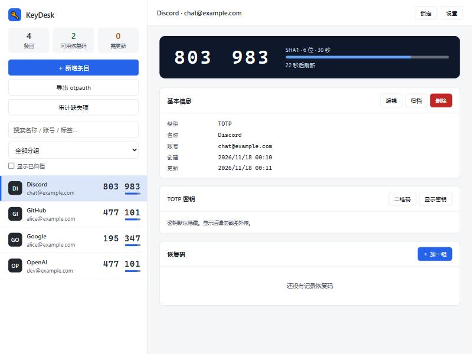

[简体中文](README.md) | English

# KeyDesk — 2FA secrets and recovery codes


A local 2FA credential manager. Zero third-party dependencies, runs entirely on your machine, and
**there is no key file** — the key is derived from the passphrase you type.

> The [Releases page](https://github.com/sqcola/maildesk-keysdesk/releases) is the source of truth for version numbers.

<p align="center">
  
</p>

## Quick start

Requires [Node.js](https://nodejs.org/) 18+.

```
Double-click start.bat
```

Or:

```bash
node server.js
```

Then open the address the terminal prints (default `http://127.0.0.1:2151`).

**The first time you open it, it asks you to paste a local auth code once.** The code lives at
`KeyDesk/data/handshake` (relative to the repository root); the server prints its absolute path on
startup (`Auth file: ...`), and following that is the surest way to find it. Open it in Notepad and
copy the whole 64-character hex line. You do this once — after that this browser remembers it
(the cookie is valid for a year).

Why this step exists: the server only listens on the loopback address, but **any process on this
machine** can connect to that port. Without this door, any program on the same machine could issue a
single `GET /api?action=handshake`, get a token, and from there read every TOTP secret you have in
plaintext.

> ⚠️ **Unlike MailDesk**: KeyDesk's auth code sits inside the **repository directory**
> (`KeyDesk/data/`), not your home directory. So the claim that it keeps out "another Windows
> account on this machine" holds only if **the repository directory itself is not readable by that
> account**. If you keep the repository somewhere world-readable like `C:\Users\Public\`, this door
> is as good as not there. Either keep the repository under your own user directory, or point it at
> a private path in your home directory with `KEYDESK_DATA_DIR`.

If you would rather not use a browser, a script can send the header directly (run this from inside
the `KeyDesk/` directory):

```bash
curl -H "X-KeyDesk-Handshake: $(cat data/handshake)" \
  "http://127.0.0.1:2151/api?action=handshake"
```

First use asks you to set a master passphrase, **and forces you to retype segments 2, 5 and 7 of the
recovery key** — copy it wrong and you don't get in, so this is the one time you genuinely have to
write it down. This is not busywork: once you dismiss the recovery key you can never view it again,
and discovering three months later, at the moment you actually need to recover, that you never wrote
it down leaves you with nothing to fall back on.

---

## What problem this solves

2FA credentials online usually end up scattered across three places: an authenticator app, a
screenshot of recovery codes saved in the browser, and some stray `.txt` file. Lose any one of those
and you have lost an account.

KeyDesk collects them into one encrypted file, and **there is no key file to steal** — the key is
derived from the passphrase you type and never touches disk. Copying the whole `data/` directory
gets an attacker ciphertext they cannot open.

---

## First use

1. Start the service (see "Quick start" above), then open the address the terminal printed

2. Open the page and set a passphrase

   At least 8 characters. **Use a long sentence you can remember — not something like `password123`.**

   The tool rejects obviously weak passphrases (anything in public breach lists, all digits, keyboard
   walks, a default word plus a numeric suffix). This is not to make life difficult: measured on this
   machine, at these scrypt parameters, `password123` falls in **4 seconds** on a 64-core server —
   and even raising the KDF parameters to the OWASP first-choice values only stretches that to
   16 seconds. **A KDF can amplify the entropy of a passphrase; it cannot create entropy.** A
   sentence like "the noodle shop downstairs is closed on Wednesdays", by contrast, costs roughly
   **3×10⁷ years** on a single core, estimated from 4-word Diceware (7776⁴ ≈ 3.7×10¹⁵ combinations)
   on the same machine — and even 64 cores in parallel only brings it to **1.2×10⁵ years**.

3. **The tool shows the recovery key once**, in the form `XXXX-XXXX-XXXX-XXXX-XXXX-XXXX-XX`
4. **You must write it down and keep it outside this tool** (print it, or write it on paper).
   The tool then **asks you to retype segments 2, 5 and 7** — you cannot get in unless they match.
   This is Apple's approach ("To complete setup, confirm your recovery key."): given only an
   "I've saved it" button, 100% of users click straight past it, and three months later, at the
   moment they actually need to recover, they find they never wrote it down — with no remedy left
   at that point. If you get it wrong, you can click "show the recovery key again" and look once
   more.

> ⚠️ **Lose both the passphrase and the recovery key and the data is permanently unreadable.**
> No backdoor, no recovery path of any kind. That is not a limitation, it is the design — a recovery
> path is an attack path.

---

## Adding an account

**Method one: paste an otpauth URI**
```
otpauth://totp/GitHub:you@example.com?secret=JBSWY3DPEHPK3PXP&issuer=GitHub
```

**Method two: paste a Base32 secret**

GitHub's 2FA settings page has "enter this text key instead" under the QR code — open it and you can
see the key. Copy that string and paste it in.

**Method three: fill in issuer + account + secret by hand**

The moment you paste, the tool **shows the current code**. Compare it against the code in the
authenticator app on your phone — if they match, the entry is correct. This is the most reliable
check available.

---

## Recovery codes

For every recovery-code set you add, it records: which generation (how many times the codes have
been regenerated), when it was generated, and which codes are used up.

**Why manage them by "generation"**: when GitHub regenerates recovery codes, the old 16 all become
invalid — **all of them** — and it gives you no warning at all. If you keep only one copy and no
date, you never know whether the copy in your hand still works.

When the current generation is more than 365 days old, the list suggests regenerating it.

---

## Backup

**Backup = copy this one file:**

```
data/vault.enc
```

The file is encrypted, so it is safe anywhere — cloud drive, USB stick, even an email attachment.

**The recovery key must be stored separately** (on paper, or in an offline password manager).
**The ciphertext and the recovery key must never be kept together** — that is the central discipline
of the whole design.

To see the current backup path and revision number: the "Vault" section of "Settings" in the top
right, or just look at `data/vault.enc`.

---

## Forgot the passphrase

1. On the lock screen, click "Unlock with recovery key"
2. Enter the string you wrote down
3. Once you are in, **go straight to Settings, change the passphrase, and generate a new recovery
   key** — the old recovery key still works, so you must replace it, otherwise it remains a
   long-term spare key.

Lost the recovery key too → the data is unrecoverable. There are no exceptions to this.

---

## Design trade-offs

### Why a separate app instead of a feature in the mail tool

The mail tool's core job is "pull **HTML written by someone else** from a remote server and render
it", and it built three lines of defence for that. A TOTP secret is a credential that **cannot be
rotated** — a `refresh_token` can be re-authorized, but a lost TOTP secret means that account's
second factor is gone for good. Putting them in the same process, under the same decryption scope,
would upgrade "any future vulnerability anywhere in the mail rendering chain" into "your GitHub
account is permanently lost".

### Why TOTP is computed on the server

The secret never enters browser memory at any point. The browser only ever receives the 6 digits.
If the front end computed the codes, then any XSS, any malicious extension, any single missed
escape would hand over the one key that cannot be rotated.

The cost is polling every 5 seconds (only while the page is visible). On loopback, that cost is
negligible.

### Why there is no QR-scan import

Decoding QR in pure JS needs finder-pattern detection + perspective correction + Reed-Solomon error
correction: 600–1000 lines, and the most expensive, most error-prone part of doing this with zero
dependencies. GitHub's page already gives you a text key, and pasting is faster and more accurate
than scanning.

(Generating a QR code *is* supported — it is there for migrating a credential to your phone. The QR
content contains the plaintext secret, so close it as soon as you have looked; don't leave it on
screen.)

---

## What it protects against, and what it does not

| Threat | Protected | Notes |
|---|---|---|
| Someone copies the `data/` directory | ✅ | Key derived from the passphrase, no key file (provided the passphrase is not in common wordlists) |
| Cloud drive / backup leak | ✅ | Same as above. **But see "Cloud-drive version history" below** |
| The disk is physically taken | ✅ | Same as above |
| A `.bak.N` backup file leaks | ✅ | Same strength as the main file (it also needs the passphrase) |
| Old passphrase stops working after a change | ⚠️ | Only if the `.bak.N` files were deleted successfully, and it **cannot reach cloud-drive version history** |
| Rollback to an older `vault.enc` | ❌ | No external anchor, so undetectable (see below) |
| A weak passphrase (one that is in a dictionary) | ⚠️ | Blocked: anything in public breach lists, all digits, keyboard walks, a default word plus a numeric suffix cannot get in. But something like `Tr0ub4dor&3` — "looks complex, actually patterned" — still cannot be assessed — **entropy comes from length, not complexity** |
| A memory dump | ❌ | The key is in memory while unlocked, and Node has no mlock |
| An infostealer (keyboard / memory / screen capture) | ❌ | **This is the biggest real-world threat**, and encryption is essentially useless against it |
| Keylogging / screen recording | ❌ | Both the passphrase and the codes pass through |
| A browser extension | ❌ | It can read the page, which is equivalent to having the codes |
| Forgetting the passphrase and losing the recovery key | ❌ | By design; there is no backdoor |
| **Other processes on this machine** | ❌ | The handshake requires the local secret in `KeyDesk/data/handshake` (the same mechanism as MailDesk), and without the secret you cannot get a token. But **any code running as the same user** can read that file and thereby take full control of the vault — this path cannot be closed with application-level authentication |
| **Staying unlocked for a long time** | ❌ | The idle lock can be set to 0 in `settings.json` (stored in plaintext, not validated), and the change survives a restart. That said, changing it first requires a token, which means getting through the handshake |
| **Old backups stop working after a passphrase change** | ❌ | A passphrase change **does not rotate the DEK**. Any historical copy of `vault.enc` + the old passphrase = permanent access to the **current** data. This is not "the cloud drive's 30-day window", it is every backup copy you have ever made. When a passphrase has leaked, changing it is not damage control — the only option is to rebuild the vault |
| **Changing the passphrase after unlocking with the recovery key** | ✅ | A session unlocked with the recovery key can **set a new passphrase directly**, without the old one. The recovery key still works afterwards (the escape hatch must not be lost), and the old passphrase stops working |

**The first row is the one that matters**. The others are not something this tool can solve; in
those situations the only line of defence is a hardware key.

### Cloud-drive version history (out of reach of a passphrase change)

If you keep `vault.enc` on a cloud drive (OneDrive / Dropbox / Nutstore and the like), then when
you change the passphrase this tool deletes the local `.bak.N` files — but **cloud drives typically
keep 30 days of version history**. Those old versions wrap the old KEK around the same DEK (a
passphrase change does not rotate the DEK, or it would destroy the recovery slot), so "old version
+ old passphrase" can still decrypt the **current** data.

If the file lives on a cloud drive, you have to go and delete the version history by hand after a
passphrase change; otherwise the change only keeps out "whoever gets the new file", not "whoever
gets an old version".

### Rollback attacks go undetected

Overwrite the new `vault.enc` with an old copy and this tool accepts it silently — the GCM check
naturally passes for "valid old ciphertext", and `revision` lives inside the encrypted payload, so
at the file level there is no plaintext anchor to compare against.

Detecting rollback needs an external anchor (the system keychain, a separate counter file), and
that is not possible under "zero dependencies + a single file". This is a design boundary, not an
oversight. The practical impact: an attacker can make you go back to some older set of TOTP
secrets, but does not get the secrets themselves.

---

## File layout

```
KeyDesk/
├── server.js          # HTTP server + API routing + security headers
├── start.bat          # one-click launch on Windows
├── selftest.js        # 241 functional self-checks (all official RFC 6238 vectors included)
├── security-test.js   # 84 security regressions
├── qr-decode-test.js  # QR reverse decoder (test only, cross-checks qr.js)
├── lib/
│   ├── totp.js        # TOTP algorithm (RFC 6238/4226)
│   ├── keystore.js    # key management (scrypt + two-slot GCM wrapping)
│   ├── instance-lock.js # single-instance lock (stops a second copy corrupting vault.enc)
│   ├── store.js       # entry CRUD + field validation
│   └── qr.js          # QR generation (pure JS, inline SVG)
├── public/
│   ├── index.html
│   ├── app.js
│   └── style.css
└── data/              # created at runtime
    ├── vault.enc      # encrypted data <- back this up
    └── vault.enc.bak.* # automatically rotated previous-generation backups
```

---

## Self-tests

```
node selftest.js        # 241 checks
node security-test.js   # 84 checks
```

`selftest.js` contains **every test vector in RFC 6238 Appendix B** (SHA1/SHA256/SHA512 × 6 time
points). That is the gold standard for verifying a TOTP implementation — if the code your phone app
shows disagrees with the code this tool computes, check those tests first.

---

## Port

Default **2151**; if it is taken, it falls through to 2152, 2153… (up to 10).

To change the port:
```
set KEYDESK_PORT=2200 && node server.js
```

---

## What this round covers, and known limitations

### All 29 actions implemented

| Group | Actions |
|---|---|
| Session | `handshake` `handshake.bootstrap` |
| Vault | `vault.status` `vault.setup` `vault.unlock` `vault.unlockRecovery` `vault.lock` `vault.changePassphrase` `vault.regenerateRecovery` `vault.settings` |
| Entries | `entries.list` `entries.get` `entries.upsert` `entries.remove` `entries.archive` |
| Codes | `otp.codes` `otp.check` `otp.verify` |
| Recovery codes | `recovery.reveal` `recovery.addSet` `recovery.setCurrent` `recovery.updateSet` `recovery.removeSet` `recovery.markCodes` |
| Other | `secrets.reveal` `audit.list` `entries.export` `export.encrypted` `print.recovery` `qr.svg` `backup.info` |

The table above matches the dispatch logic in `server.js` one entry per `case`; all 29 are listed.

### QR: a complete implementation, not a cut-down one

`lib/qr.js` implements the full QR encoding chain: byte mode, automatic version selection from 1 to
10, ECC level M, Reed-Solomon error correction, penalty scoring across all 8 masks, and BCH format
information. It is not a half-finished thing that can "just about" produce an otpauth URI.

`qr-decode-test.js` is the matching **independent decoder** (test only): `selftest.js` uses it to
decode the generated matrices all the way back to the original text and verify the RS and format
information — 210 different lengths, across all 10 versions.

The reason for writing a decoder: a QR code is the only output this tool produces where **a
generation bug is invisible to the naked eye**, and "the matrix isn't empty" is not a test.

### Front end: minimum viable only, this round

- Lock screen: first-time setup / unlock with passphrase / unlock with recovery key
- **After first-time setup, mandatory retype of 3 segments of the recovery key** (Apple's approach).
  The old "I've saved it, let me in" was a zero-friction button — 100% of users clicked straight
  through, and once the recovery key was dismissed it could never be seen again, so three months
  later, at the moment they actually needed to recover, they found they had never written it down.
  Now you cannot get in without typing it correctly, and "show it again" is there as the escape
  hatch
- Entry list: issuer + account + current code + countdown bar
- Polls `otp.codes` every 5 seconds, only while the page is visible; the countdown is calibrated
  against the server's `now`
- Click to copy a code (**the copy confirmation appears in place, and says which account's code it was**)
- Recovery codes: grouped view, **click a whole block to copy it**, mark individual codes as used
  (and see which day they were used), add / remove a set, switch the current generation, **print
  view** (for marking codes used on paper)
- Add / edit entries (paste an otpauth URI or a bare Base32 secret); while entering, **the current
  code is shown side by side so you can compare it against your phone**
- **Audit view**: lists at a glance the entries with "no 2FA", "no recovery codes", "recovery codes
  are stale", and "no password stored" — a quarterly audit goes from "open them one by one" to
  "take one look"
- Settings: idle lock, change passphrase, regenerate the recovery key, **encrypted export bundle**
- Keyboard: `/` focuses search, `Ctrl+C` copies the current code, `Ctrl+L` locks, `↑`/`↓` move,
  `Enter` opens

**Not done**: drag-to-reorder, bulk import, importing a QR image, custom entry icons in the UI.

**Done, and worth explaining**: the encrypted export bundle (`export.encrypted`) uses an independent
salt / IV and the domain-separated AAD `keydesk/export/1`, so an export cannot be used as a
`vault.enc` and vice versa. This is currently the only way to produce "a second independent
encrypted copy" — before this, the backup strategy could only be "copy vault.enc", and `.bak.1/.2/.3`
all sit in the same directory, so a disk failure took them all.

### Known behaviours

- The `recovery-only` type lets you create an empty entry first and add the recovery codes
  afterwards (creating and pasting are two separate calls).
- Leaving `secret` blank when editing an entry means "keep the existing secret"; it is only
  inherited if the type is still `totp`.
- Idle locking is **lazy**: with no requests coming in, it does not lock on its own — the next
  request that arrives is evaluated first and then rejected.
- On Windows `chmod 600` is a no-op; file permissions are decided by the ACL on your user directory.


---

## ⚠️ Known defects (0.1.0-SNAPSHOT)

The problems below were confirmed during public review and **genuinely exist in the current
version**; judge the risk for yourself until they are fixed.

> **Fixed after 0.1.0-SNAPSHOT**: the handshake no longer hands out a token unconditionally (it now
> needs `KeyDesk/data/handshake`), an instance lock was added (a second copy refuses to start
> instead of corrupting `vault.enc`), and a session unlocked with the recovery key can change the
> passphrase directly. These three are no longer listed as defects below.

### 1. A passphrase change does not rotate the DEK — old backups can decrypt current data forever

The DEK stays the same when you change the passphrase (in order to keep the recovery slot working;
that trade-off is itself correct). But it follows that **any historical copy of `vault.enc` + the old
passphrase = permanent access to the current data.** Not "the cloud drive's 30-day window" — every
backup copy you have ever made.

**If you suspect the passphrase has leaked, changing it is not damage control.** You have to assume
every copy you ever made is already in the adversary's hands, regenerate all the TOTP secrets in
them (go to each site and re-enroll 2FA), or simply rebuild the vault.

### 2. An encrypted export cannot be restored inside this tool

`export.encrypted` can produce an encrypted backup bundle, but **there is no corresponding import
entry point**. For now the only way is to write your own script that calls `openExport()` in
`store.js`.

**Mitigation**: keep using "copy `vault.enc`" for day-to-day backups, and treat the export bundle
as an extra offline snapshot.
