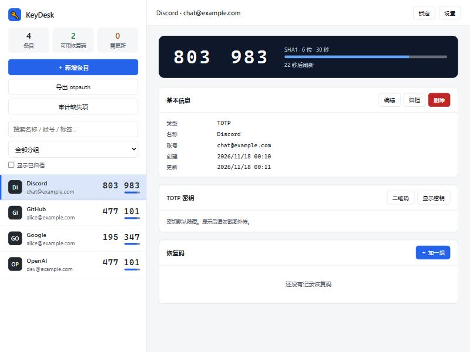

# KeyDesk — 2FA 密钥与恢复码管理

本地 2FA 凭据管理工具。零第三方依赖，纯本地运行，**没有密钥文件**——密钥从你输入的口令派生。

<p align="center">
  
</p>

## 快速开始

需要 [Node.js](https://nodejs.org/) 18+。

```
双击 start.bat
```

或者：

```bash
node server.js
```

然后打开终端打印的地址（默认 `http://127.0.0.1:2151`）。

首次使用会让你设一个主口令，**并强制回填恢复密钥的第 2、5、7 段**——抄错就进不去，
所以这一次必须真抄下来。这不是刁难：恢复密钥关闭后无法再查看，三个月后真要恢复时
才发现没抄，那时已经没有任何补救办法。

---

## 这个工具解决什么问题

网上的 2FA 凭据通常散在三处：验证器 App、浏览器里存的恢复码截图、
某个 txt 文件。丢一处就等于丢一个账号。

KeyDesk 把它们收在一个加密文件里，**没有密钥文件可偷**——密钥从你输入的口令
派生，不落盘。拷走整个 `data/` 目录只能拿到解不开的密文。

---

## 第一次使用

2. 打开页面，设置口令

   至少 8 字符。**用一句好记的长句，不要用 `password123` 这种。**

   工具会拒绝明显弱的口令（公开泄露表里的、纯数字、键盘序、默认词+数字后缀）。
   这不是为了刁难——按实测，`password123` 在这台机器的 scrypt 参数下，
   64 核服务器 **4 秒**就能试出来；即使把 KDF 参数提到 OWASP 首推值也只是 16 秒。
   **KDF 只能放大口令的熵，不能创造熵。** 而一句「楼下那家面馆周三不开门」
   的破解成本是 10^15 年级别的（4 词 Diceware 的实测数字）。

3. **工具会显示一次恢复密钥**，形如 `XXXX-XXXX-XXXX-XXXX-XXXX-XXXX-XX`
4. **必须抄下来，存在本工具之外**（打印或写纸上）。
   接下来工具会**抽第 2、5、7 段让你回填**——填对才能进入。这是 Apple 的做法
   （"To complete setup, confirm your recovery key."）：如果只给一个
   「我已保存」按钮，用户 100% 会直接点过去，三个月后真要恢复时才发现没抄，
   而那时已经没有任何补救办法。填错了可以点「重新显示恢复密钥」再看一遍。

> ⚠️ **口令和恢复密钥都丢 = 数据永久不可读。** 没有任何后门，没有任何找回途径。
> 这不是限制，是设计——有找回途径就等于有攻击途径。

---

## 添加一个账号

**方式一：粘贴 otpauth URI**
```
otpauth://totp/GitHub:you@example.com?secret=JBSWY3DPEHPK3PXP&issuer=GitHub
```

**方式二：粘贴 Base32 secret**

GitHub 在 2FA 设置页的二维码下面有「enter this text key instead」，
点开就能看到。复制那串字符粘进来。

**方式三：手填 issuer + account + secret**

粘贴后工具会**立刻显示当前验证码**。拿你手机上验证器 App 的码对照一下，
一样就说明录对了——这是最可靠的校验方式。

---

## 恢复码

每加一组恢复码，记录：哪一代（第几次生成）、什么时候生成、哪些已用掉。

**为什么按「代」管理**：GitHub 重新生成恢复码会让旧的 16 个**全部失效**，
而且不会有任何提示。如果只存一份、不记日期，你永远不知道手里这份还能不能用。

当前代超过 365 天时，列表会提示「建议重新生成」。

---

## 备份

**备份 = 拷这一个文件：**

```
data/vault.enc
```

这个文件是加密的，放哪都安全——网盘、U 盘、邮件附件都行。

**恢复密钥必须单独存**（纸上/离线密码管理器）。
**密文和恢复密钥绝不能放在一起**——这是整套设计的核心纪律。

看当前备份路径与修订号：右上角「设置」里的「密钥库」一栏，或直接看 `data/vault.enc`。

---

## 忘了口令

1. 锁屏页点「用恢复密钥解锁」
2. 输入你抄下来的那串
3. 解锁后**立刻去「设置」改口令并重新生成恢复密钥**——旧恢复密钥仍然有效，
   所以务必要换掉，否则它就成了一条长期的备用钥匙。

恢复密钥也丢了 → 数据不可恢复。这一点没有例外。

---

## 设计取舍

### 为什么单独一个应用，不集成进邮件工具

邮件工具的核心工作是「从远端拉**别人写的 HTML** 并渲染」，它为此建了三道防线。
TOTP secret 是**不可轮换**的凭据——refresh_token 可以重新授权，TOTP secret 丢了
就是永久失去那个账号。放进同一进程、同一解密作用域，等于把「邮件渲染链上的
任意未来漏洞」升级成「GitHub 账号永久失守」。

### 为什么 TOTP 在服务端算

secret 全程不进浏览器内存。浏览器只拿到 6 位数字。
如果前端算，任何 XSS、任何恶意扩展、任何一处漏掉的转义，都会交出去最不可
轮换的那把钥匙。

代价是每 5 秒轮询一次（仅页面可见时）。本地回环，成本可忽略。

### 为什么没有二维码扫描导入

纯 JS 解码 QR 需要定位图案检测 + 透视校正 + Reed-Solomon 纠错，600-1000 行，
是零依赖下最贵最容易写错的一块。而 GitHub 页面本来就提供了文本密钥，
粘贴比扫码更快更准。

（「生成」二维码是支持的——用于把凭据迁移到手机。二维码内容含明文密钥，
  看完随手关掉，别留在屏幕上。）

---

## 能防什么，防不住什么

| 威胁 | 能防 | 说明 |
|---|---|---|
| 拷走 data/ 目录 | ✅ | 口令派生密钥，没有密钥文件（前提：口令不在常见口令表里） |
| 网盘/备份泄露 | ✅ | 同上。**但见下面「云盘历史版本」** |
| 磁盘被物理拿走 | ✅ | 同上 |
| 备份文件 `.bak.N` 泄露 | ✅ | 与主文件同等强度（同样需要口令） |
| 改口令后旧口令失效 | ⚠️ | 仅当 `.bak.N` 清除成功，且**管不到云盘历史版本** |
| 回滚到旧版 vault.enc | ❌ | 无外部锚点，检测不到（见下） |
| 弱口令（在字典里） | ⚠️ | 已被拦下：公开泄露表里的、纯数字、键盘序、默认词+数字后缀都进不来。但 `Tr0ub4dor&3` 这类"看着复杂实际有模式"的仍评估不了——**熵来自长度，不来自复杂度** |
| 内存 dump | ❌ | 解锁期间密钥在内存里，Node 没有 mlock |
| infostealer（键盘/内存/截屏） | ❌ | **这是最大的实际威胁**，加密对它基本无效 |
| 键盘记录 / 录屏 | ❌ | 口令和验证码都会经过 |
| 浏览器扩展 | ❌ | 能读页面，等价于拿到验证码 |
| 忘口令且丢恢复密钥 | ❌ | 设计如此，没有任何后门 |

**最重要的是第一行**。后几类不是这个工具能解决的，那种情况下唯一的防线是硬件密钥。

### 云盘历史版本（改口令管不到）

把 `vault.enc` 放在 OneDrive / Dropbox / 坚果云里，改口令时本工具会清除本地
`.bak.N`，但**云盘通常保留 30 天历史版本**。那些旧版本里包的是旧 KEK +
同一个 DEK（改口令不换 DEK，否则会毁掉恢复槽），所以「旧版本 + 旧口令」
仍然能解开**当前**数据。

改口令后如果文件在云盘上，必须手动去删历史版本；否则这次改口令只挡住了
"拿到新文件的人"，挡不住"拿到旧版本的人"。

### 回滚攻击检测不到

用一份旧版 `vault.enc` 覆盖新的，本工具会静默接受——GCM 校验对"合法的旧密文"
当然通过，而 `revision` 存在加密载荷内部，文件层没有明文锚点可以比对。

要检测回滚需要外部锚点（系统钥匙串、独立计数器文件），在"零依赖 + 单文件"
的前提下做不到。这是设计边界，不是遗漏。实际影响：攻击者可以让你退回到
某组旧的 TOTP secret，但拿不到 secret 本身。

---

## 文件结构

```
KeyDesk/
├── server.js          # HTTP 服务 + API 路由 + 安全头
├── start.bat          # Windows 一键启动
├── selftest.js        # 181 项功能自检（含 RFC 6238 全部官方向量）
├── security-test.js   # 71 项安全回归
├── qr-decode-test.js  # 二维码反向解码（仅测试用，交叉验证 qr.js）
├── lib/
│   ├── totp.js        # TOTP 算法（RFC 6238/4226）
│   ├── keystore.js    # 密钥管理（scrypt + 双槽 GCM 包裹）
│   ├── store.js       # 条目 CRUD + 字段校验
│   └── qr.js          # 二维码生成（纯 JS，内联 SVG）
├── public/
│   ├── index.html
│   ├── app.js
│   └── style.css
└── data/              # 运行时生成
    ├── vault.enc      # 加密数据 ← 备份这个
    └── vault.enc.bak.*# 自动轮转的上一代备份
```

---

## 自检

```
node selftest.js        # 181 项
node security-test.js   # 71 项
```

`selftest.js` 里有 **RFC 6238 附录 B 的全部测试向量**（SHA1/SHA256/SHA512 × 6 个时间点）。
这是验证 TOTP 实现正确性的黄金标准——如果你的手机 App 和这个工具算出的码不一致，
先看这些测试有没有过。

---

## 端口

默认 **2151**，被占用时自动顺延到 2152、2153…（最多 10 个）。

改端口：
```
set KEYDESK_PORT=2200 && node server.js
```

---

## 本轮实现范围与已知限制

### 26 个 action 全部实现

| 组 | action |
|---|---|
| 会话 | `handshake` |
| 密钥库 | `vault.status` `vault.setup` `vault.unlock` `vault.unlockRecovery` `vault.lock` `vault.changePassphrase` `vault.regenerateRecovery` `vault.settings` |
| 条目 | `entries.list` `entries.get` `entries.upsert` `entries.remove` `entries.archive` |
| 验证码 | `otp.codes` `otp.check` `otp.verify` |
| 恢复码 | `recovery.reveal` `recovery.addSet` `recovery.setCurrent` `recovery.updateSet` `recovery.removeSet` `recovery.markCodes` |
| 其它 | `secrets.reveal` `entries.export` `qr.svg` `backup.info` |

（需求文档里的 action 表逐行数下来是 26 条，全部实现；文中的「23 个」是计数笔误。）

### 二维码：完整实现，不是简化版

`lib/qr.js` 实现了完整的 QR 编码链：byte mode、version 1-10 自动选择、
ECC level M、Reed-Solomon 纠错、8 个掩码的罚分评估、格式信息 BCH。
不是「只够生成 otpauth URI」的半成品。

`qr-decode-test.js` 是配套的**独立解码器**（仅测试用）：`selftest.js` 用它把生成的
矩阵完整解回原文并校验 RS 与格式信息——210 种长度、全部 10 个版本都验证过。

之所以要写解码器：二维码是本工具唯一「生成错了肉眼看不出来」的输出，
只看矩阵非空等于没测。

### 前端本轮只做最小可用

- 锁屏：首次设置 / 口令解锁 / 恢复密钥解锁
- **首次设置后强制回填恢复密钥的 3 段**（Apple 的做法）。原来那个
  「我已保存，进入」是零摩擦按钮，用户 100% 直接点过去，而恢复密钥关掉后
  再也看不到 —— 三个月后真要恢复时才发现当时没抄。现在不填对进不去，
  并有「重新显示」这条逃生门
- 条目列表：issuer + account + 当前码 + 倒计时条
- 每 5 秒轮询 `otp.codes`，仅页面可见时；倒计时用服务端 `now` 校准
- 点击复制验证码（**复制反馈在原地显示，且说明是哪个账号的码**）
- 恢复码：分组查看、**整块点击即复制**、逐码标记已用（并显示是哪天用的）、
  加组 / 删组 / 切换当前代、**打印视图**（纸面标记已用）
- 新增 / 编辑条目（粘贴 otpauth URI 或裸 Base32），录入时**并排显示当前码
  供与手机对照**
- **审计视图**：一眼列出「没开 2FA」「没有恢复码」「恢复码已过期」
  「没存密码」的条目 —— 季度审计从"逐个点开"变成"看一眼"
- 设置：空闲锁定、改口令、重新生成恢复密钥、**加密导出备份包**
- 键盘：`/` 聚焦搜索、`Ctrl+C` 复制当前码、`Ctrl+L` 锁定、`↑`/`↓` 移动、
  `Enter` 打开

**没做**：拖拽排序、批量导入、导入 QR 图片、条目图标自定义 UI。

**已做但值得说明**：加密导出备份包（`export.encrypted`）用独立 salt / IV 和
域分离 AAD `keydesk/export/1`，所以导出包不能被当成 `vault.enc` 用，
反之亦然。这是目前唯一能生成"第二份独立加密副本"的方式 —— 在此之前
备份策略只能是"拷 vault.enc"，而 `.bak.1/.2/.3` 全在同一目录，磁盘坏了全没。

### 已知行为

- `recovery-only` 类型允许先建空条目再补恢复码（新建和粘贴是两次调用）。
- 「编辑条目时留空 secret」表示保持原密钥不变；只有类型仍是 `totp` 时才继承。
- 空闲锁定是**惰性**的：没有请求进来就不会主动锁，下一个请求到达时先判定再拒绝。
- Windows 上 `chmod 600` 是空操作，文件权限由用户目录的 ACL 决定。

