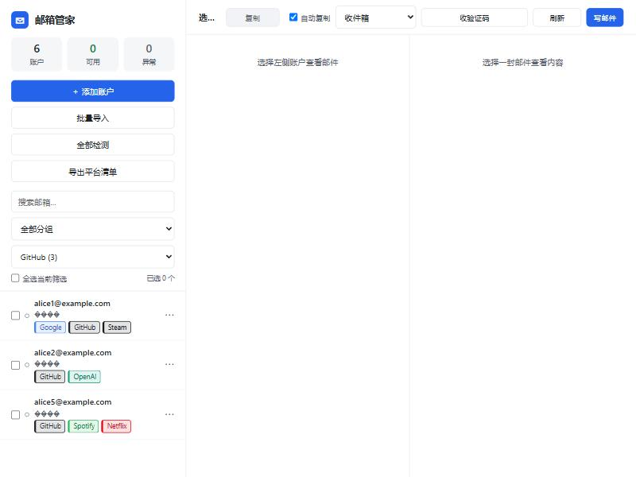

[简体中文](README.md) | English

# MailDesk


A zero-dependency local mail management tool: manage Outlook / Microsoft accounts in bulk — read and send mail, collect verification codes in batches, and record which third-party services each mailbox has signed up for.

> For the version number, the [Releases page](https://github.com/sqcola/maildesk-keysdesk/releases) is authoritative.

<p align="center">
  
</p>

---

## Quick start

### 1. Requirements

You only need **Node.js 18 or newer** ([download](https://nodejs.org/)). No `npm install`, no dependency packages of any kind.

Check the version:

```
node --version
```

### 2. Start it

Double-click `start.bat`, or run this from a terminal:

```
node server.js
```

The terminal prints the address — open it in a browser.

### 3. First authorization

First launch generates a local auth code and stores it at `~/.maildesk/handshake`. The page asks you to paste it in.

This step exists to keep out **other processes on the same machine and other Windows accounts**, not to stop attacks over the network (the server only listens on `127.0.0.1`). See [the local auth model](#the-local-auth-model) below.

---

## Why rewrite instead of patching the old one

Static analysis of the original `邮箱管家.exe` confirmed **no backdoor**, but it had several product-level defects that leak credentials outright:

| Problem in the original | How this tool fixes it |
|---|---|
| Mail bodies went into `innerHTML` unescaped, so one malicious HTML email was enough to steal every credential | All text is forced through `esc()`; HTML mail goes into a `sandbox` iframe where scripts cannot run |
| Credentials stored in browser localStorage as plaintext | Encrypted to disk with AES-256-GCM; the key file `vault.key` is mode 0600 |
| CORS `Access-Control-Allow-Origin: *`, so any web page could call the local API | Only this port's origin is allowed; a bad Origin gets no CORS header at all |
| The local API had no authentication | See "The local auth model" below — the handshake trades a local secret for a cookie, and the ACLs on `vault.key` / `accounts.enc` are tightened to the current user only |
| IMAP `CERT_NONE` turned certificate validation off, leaving it open to a man-in-the-middle | All TLS is strictly validated; `rejectUnauthorized: false` **does not exist** anywhere in the code |
| Depended on the jsDelivr CDN (no SRI, and a CVE) | **Zero third-party dependencies**; every asset is served locally |

### The local auth model

**This layer defends against "another process on the same machine, or another Windows account on it", not against attacks over the network.**

The server only listens on `127.0.0.1`, so it is unreachable from outside. But other programs on this machine (and other signed-in Windows accounts on it) can connect to `127.0.0.1:2131` directly. A random token that every endpoint validates does not stop them — the token is handed out unconditionally by `/api?action=handshake`.

There are three layers now:

1. **The handshake needs a local secret.** First launch generates `~/.maildesk/handshake` (256 bits of random), and the browser has to paste it into the page before it can trade it for a session cookie. Other processes cannot read that file (its ACL is tightened to the current user only), and they also fail the `Sec-Fetch-Site: same-origin` check. The cookie stores an HMAC of the secret rather than the secret itself, and it is `HttpOnly; SameSite=Strict`.
2. **Key files are tightened to the current user.** At startup, `icacls` strips inheritance from the ACLs on `vault.key` and `accounts.enc` and grants the current account only. Otherwise a second admin account can read both the key and the ciphertext and walk straight around layer 1.
3. **Refresh tokens are encrypted to disk and bound with AAD.** Each account's ciphertext uses `maildesk/2|<accountId>` as its AAD, so moving a ciphertext from account A's slot to account B's fails authentication instead of decrypting into the wrong record. Old v1 files are still readable and are upgraded automatically on the next save.

**What it still cannot stop**: programs that can read your process memory or your keyboard (infostealers), or malware running under your own account. At that point encryption and ACLs are both moot — it is already you. Isolation between Windows accounts rests on the OS ACLs; if you loosen the permissions on the whole `~/.maildesk` directory, layer 2 stops working.

---

## What you need in order to add an account

**Microsoft has fully disabled password login for Outlook** (IMAP basic auth). A password will always fail, so this tool only accepts:

- `client_id` (the Azure application ID you registered)
- `refresh_token`

### Batch import format

One account per line, four separators supported (`----`, `|`, comma, tab):

```
a@outlook.com----xxxxxxxx-xxxx-xxxx-xxxx-xxxxxxxxxxxx----M.C5xxxxx...
b@outlook.com | xxxxxxxx-xxxx-xxxx-xxxx-xxxxxxxxxxxx | M.C5xxxxx...
```

Lines starting with `#` are ignored.

The four-column layout is also recognized, **in any column order** (email, password, `client_id`, `refresh_token`):

```
邮箱----密码----client_id(GUID)----refresh_token(M.C...)
```

The tool decides by content, not by position: `client_id` has the shape of a GUID, `refresh_token` is the longest field (usually 400+ characters starting with `M.C`), and the remaining short string is stored as the password. That way a swapped column order still imports correctly.

> Earlier versions took columns by position, so in the four-column layout the password became `client_id` and `client_id` became `refresh_token`, and every account reported `AADSTS7000012` / `AADSTS9002313`. If you see either of those two errors, first check whether what you imported was the four-column layout.

---

## What to do about AADSTS errors

A `refresh_token` must be redeemed against **the endpoint that issued it**. Accounts from a bulk file come from different places, so the endpoint differs:

| Endpoint | Used for | Address |
|---|---|---|
| `consumers` | Personal accounts only (@outlook.com / @hotmail.com) | login.microsoftonline.com/consumers |
| `common` | Generic | login.microsoftonline.com/common |
| `organizations` | Work / school accounts | login.microsoftonline.com/organizations |
| `live` | Legacy MSA tokens | login.live.com/oauth20_token.srf |

**By default the tool probes for you**: it tries all four endpoints in turn, remembers the one that hits, and reuses it from then on.

Personal accounts (`@outlook.com` / `@hotmail.com`) **work with either `consumers` or `common`** — confirmed by measurement.

What the common errors mean:

| Error code | Meaning | What to do |
|---|---|---|
| `AADSTS7000012` | The authority used for the redemption does not match the one that issued the grant | First check that the import columns were not misread (see "Batch import format" above); a personal account should never produce this |
| `AADSTS9002313` | A generic "request is invalid or malformed" | This code is not in Microsoft's documentation; in practice it is the catch-all for malformed credentials on `/common` and `/organizations` |
| `AADSTS40016` | The identity provider returned an error | Personal accounts use consumers, work accounts need their tenant |
| `AADSTS700016` | The application was not found in that directory | The `client_id` does not exist, or that app is not registered in the tenant you are requesting |
| `AADSTS70000` | The token is no longer valid | Get a new token |
| `AADSTS700082` | The token expired (long disuse) | Get a new token |
| `AADSTS50173` | The session expired | Authorize again |
| `AADSTS65001` | No consent record for this (application, user, resource) | A personal account pointed at `/organizations` gives exactly this; it is expected, not "admin consent required" |
| `AADSTS9002332` | This app allows organizational accounts only, so it should not be sent to `/consumers` | Switch to `/organizations` or a tenant endpoint |

> **Measured**: accounts from one batch usually share a `client_id` (issued by the same Azure app), and their `refresh_token` is a 481-character `M.C...` string. Request `/consumers` with the right columns and you get HTTP 200 with an access_token straight away. Every earlier `AADSTS7000012` was an artifact of misaligned import columns.

### Endpoint choice: pin `consumers`

`/consumers` and `/common` sit in front of the same token service, and personal accounts work with both. **We recommend pinning `/consumers`**, because:

- It serves personal accounts only, so its meaning is unambiguous. If an organizational account is fed in by mistake you get a clean `AADSTS9002332`, instead of silently receiving a token for a tenant you have never heard of
- `/common` re-routes by account type, so its behavior depends on who is signing in

`/consumers` is in fact a proxy entry point in front of `login.live.com` — Microsoft itself 302s you there. So using `/consumers` means reaching the same backend through the new address, and **you neither need nor should use `login.live.com/oauth20_token.srf` directly**: that is the old interface, deprecated, undocumented, with no SLA, bypassing every conditional access policy — and it does not validate the scope parameter (pass the wrong one and you still get `invalid_grant`, with no clue for troubleshooting).

A personal account hitting `/organizations` always gets `AADSTS65001`. That is not a permission problem and **adding admin consent will not fix it** — a personal account is not in any organizational tenant at all. That combination means "wrong endpoint".

### refresh_token rotation and expiry

Microsoft issues a new refresh_token after every successful refresh. Key points:

- **Assume "redeeming it kills the old one" and do not rely on a grace period.** Microsoft does not
  publicly promise how long an old value survives after redemption, and behaviour differs between
  tenants and over time. This tool always takes the most conservative assumption: **if the new value
  did not reach disk, that account is treated as lost.** That way, if the old value ever really does
  die instantly, you still do not lose the account
- **You must write the new token back to the account store.** If something else is refreshing the
  same batch of tokens, whoever refreshes first takes the new value and the other party eventually fails
- The tool enforces this: **it refuses to refresh** when no persistence callback is wired up — an error is preferable to silently destroying a credential

> **There is no way to tell from an error code whether a third party is using the same tokens.** I previously wrote here that "a flood of `AADSTS700082` means someone else is using them at the same time" — that inference does not hold; `700082` means "the token expired from long disuse" and has nothing to do with concurrent refresh. No client-visible signal currently proves that a third party is refreshing the same tokens. What you can do: if one day accounts fail in droves, and redeeming the original `refresh_token` also fails, then that credential is no longer in your hands.

---

## Features

- **Account management**: add, batch import, group, search, delete, copy the address, one-click diagnosis
- **Platform tags**: record which third-party services each mailbox signed up for (17 built in, plus custom), filter by platform, configure in bulk, export the list
- **Liveness checks**: single or batch, whether the token is still valid and whether the account is banned
- **Receiving mail**: browse the inbox / junk / sent and other folders, read message bodies
- **Sending mail**: plain-text mail over SMTP + XOAUTH2
- **Batch code collection**: select many accounts and scan them in one pass, with a progress bar you can cancel; results grouped by account
- **Code history**: scan results are written to disk encrypted, so closing the page or restarting loses nothing; mark codes as used, search by account or keyword, export as text
- **Encrypted storage**: every sensitive credential is encrypted before it is stored locally

---

## Platform tags

Each mailbox can be tagged with the third-party services it has signed up for. Two uses: **find the mailbox for a platform** (when you need to change a password on some service, first find which mailboxes are bound to it), and **export the list** (offline archive or handover).

### Entering them

Open an account → the "Platform accounts" column (`平台账号`) → "+ Add platform" (`＋ 添加平台`).

17 are built in: Google, GitHub, Microsoft, Apple, Steam, Discord, Telegram, X / Twitter, Facebook, Reddit, Twitch, Netflix, Spotify, Amazon, PayPal, OpenAI, Anthropic. If yours is not there, type a name — anything can be added (`Vercel`, `my blog`, `ChatGPT Plus`).

**Custom platform names keep the exact casing you typed.** Two copies are stored internally: a lowercase key for filtering and deduplication, and the original spelling for display — otherwise typing `Vercel` would show up as `vercel` and look like a bug.

### Bulk editing

Tick several accounts in the sidebar → "Tag platforms" (`标注平台`) → pick one of the three modes **add / remove / set to**.

Bulk editing goes through a single `upsertMany` rather than a loop of writes. The loop is O(N²) (every write decrypts and re-encrypts the whole store), and 100 accounts would stall for tens of seconds; a bulk set on 50 accounts now measures 31ms.

### Filtering

The sidebar's "All platforms" (`全部平台`) dropdown shows counts, e.g. `GitHub (5)`. It combines with the search box and the group dropdown using **AND**.

### Export

The sidebar's "Export platform list" (`导出平台清单`) produces a CSV:

```
邮箱,标签,分组,平台,平台数量
alice@outlook.com,,默认,GitHub; Vercel,2
```

The header row is in Chinese because that is literally what the app writes: `邮箱,标签,分组,平台,平台数量` means email, label, group, platform, platform count, and `默认` is the default group name.

UTF-8 with a BOM, so Excel opens it on a double-click without mojibake. Platforms are joined with `; ` rather than a comma so they do not collide with the CSV separator; fields containing a comma, quote or newline are escaped per RFC 4180.

**The export contains metadata only, never any credential** — not a single `refresh_token` or `client_id` appears in it.

### One implementation detail: color contrast

The 17 platform brand colors differ wildly (GitHub nearly black, Twitch purple, Amazon orange). The palette is not hand-picked: starting from the brand color it is **darkened step by step until it reaches 4.6:1 against the background**. Measured worst cases are Netflix at 4.60 for text and Microsoft at 3.10 for borders — all of them satisfy WCAG 1.4.3 (4.5:1 for text) and 1.4.11 (3:1 for non-text).

---

## Code history

After every batch scan, the verification codes it recognized are written automatically to `data/history.enc`. Closing the page or restarting the service loses nothing.

**Only 8 fields are stored**: `accountId` / `accountEmail` / `code` / `senderDomain` / `receivedAt` / `usedAt` / `confidence` / `id`.

> Why the subject, the sender display name and the body are **not** stored: those are entirely under the sender's control. Persist them and a malicious mail that arrives today is still being rendered into the DOM three months later — turning a one-off injection into a stored one, where any escaping gap introduced in the future retroactively affects all history. The less you store, the smaller the attack surface on re-render.

Other constraints:
- The whole file is encrypted with AES-256-GCM under the same key as the account store, so **no plaintext code ever sits on disk**
- `id = sha1(accountId:uid:code)`, so scanning the same mail 10 times records it once
- Capped at 2000 entries / 7 days; anything beyond that is trimmed automatically
- Every field passes a whitelist regex before it is written; anything non-compliant is **dropped and counted**, never aborting the whole batch

---

## Batch code collection

Tick several accounts in the sidebar → click "Collect codes" (`收验证码`) → watch the progress → results are listed grouped by account.

**Performance**: roughly 5-10 seconds per account (token refresh + TLS handshake + fetch), with concurrency fixed at 3. Ten accounts take about 25 seconds, a hundred about 4 minutes.

> Why concurrency is not set higher: at concurrency 9 the total time only fell from 188s to 175s (-7%), while per-account latency rose from 5.6s to 15.8s (+180%). The bottleneck is Microsoft-side rate limiting, not the local machine, so concurrency is hard-coded to 3 and not exposed to the front end. Raising it only makes every account slower while total time barely moves.

**Security design (none of this is optional)**:

- Results are **grouped by account**, and within a group ordered by IMAP UID descending; **never sorted by time across accounts**. The `Date:` header is entirely under the sender's control — forge it to 2099 and a self-sent code sorts to the top, the user copies it and hands the attacker's code to the platform, and the account goes with it. UID is assigned monotonically by the IMAP server and cannot be forged.
- Every result **always shows the full address** and **the sender domain** (the last two labels of the domain in bold, never truncated) — that is the only clue a user has that "the domain is wrong".
- **There is no "copy all" button, and the aggregate path does not auto-copy.** Clicking row by row is the only way to copy.
- While the results panel is open, the per-account "auto-copy" is forced off, so the clipboard is never silently overwritten.

**Shutting down does not destroy accounts**: Microsoft rotates the refresh_token on every refresh, and
the tool assumes the old value dies on redemption (see "refresh_token rotation and invalidation" above).
So on Ctrl+C / closing the window / a crash, the service first waits for every in-flight token redemption
to reach disk (15 seconds at most) before exiting, and the console prints "waiting for N token redemptions
to be written, do not force-close the window". Closing a console window on Windows sends `SIGBREAK`
(not `SIGINT`), and that is handled too.

---

## Security design

### Credential protection

- Passwords and refresh_token are encrypted with **AES-256-GCM** and written to `data/accounts.enc`
- The key is stored **outside the data directory**: `~/.maildesk/vault.key` (see "Where the key lives" below)
- **No plaintext credential ever appears on disk** (covered by a self-test assertion)
- The front end never receives a refresh_token; list responses return only the first 8 characters as a hint
- The repository-root `.gitignore` excludes `data/`, `vault.key` and `.maildesk/`, so nothing is committed by accident

> ⚠️ **chmod does nothing on Windows**: `mode: 0o600` is ignored on Windows (you actually get 0666), and the only real protection is the NTFS default ACL. So **do not put the project on a synced drive or a shared directory** — leaking either `vault.key` or `accounts.enc` means leaking every account.

### Where the key lives (K2: key and ciphertext kept apart)

Early versions kept `vault.key` in `data/` next to `accounts.enc`. The problem: **copying the whole `data/` folder gets you both the key and the ciphertext**, at which point AES-256-GCM buys you nothing — one folder copy takes every account with it.

The key now lives separately:

| Situation | Key location |
|---|---|
| Normal start | `~/.maildesk/vault.key` (`C:\Users\<your-username>\.maildesk\vault.key`) |
| `MAILDESK_KEY_DIR` set | `$MAILDESK_KEY_DIR/vault.key` (highest priority) |
| `MAILDESK_DATA_DIR` set | Still inside the data directory (for tests and custom deployments; keeps the original meaning) |

That leaves only undecryptable ciphertext in `data/`, and **copying `data/` on its own no longer decrypts anything**.

**The upgrade is automatic**: the first launch of a new version detects the old location (`data/vault.key`), moves it to `~/.maildesk/`, reads it back, compares byte for byte, and only then deletes the old file. The migration **never rewrites `accounts.enc`** (the key moves, the ciphertext does not), and a power loss at any step leaves either "two identical keys" or "the move not finished", so the next start redoes it idempotently.

If the two keys **differ in content**, the program **refuses to start outright** and prints both absolute paths — silently picking either one would leave the other batch of data permanently unreadable. Use `tools/check-key.js` to decide which one to keep:

```
node tools/check-key.js
```

It tries both keys against `data/accounts.enc` and reports which one works and how many accounts it recovers. Exit codes: 0 if one works, 1 if neither does.

Once you have confirmed `~/.maildesk/vault.key` works, you can clean up the old copy in the data directory:

```
node tools/check-key.js --purge-legacy
```

(`--purge-legacy` asks for interactive confirmation; a script can pass `--yes` to skip it. When the two differ in content it refuses to delete by default and requires an explicit `--force` — that is a one-of-a-kind key.)

### Network hardening

- The server binds `127.0.0.1` only and never listens on an external interface
- **The `Host` header is validated** as `127.0.0.1:<port>` or `localhost:<port>` — the only defense against DNS rebinding (under rebinding the browser believes the request is same-origin and never runs the CORS check at all)
- A fresh random token (64 hex characters) is generated at every start, and endpoints compare it in constant time
- The CORS allowlist contains only this port's origin and **never falls back to `*`**
- Static file paths are strictly validated, blocking `../`, `%2e%2e`, `..\` and UNC traversal
- The request callback is wrapped in try/catch with an `uncaughtException` backstop, so a malformed request cannot take the process down

### Mail rendering

- Plain-text mail: escaped, then rendered preserving line breaks
- HTML mail: placed in an `<iframe sandbox>`, so even a body containing `<script>` cannot execute and cannot reach the parent page's token
- Every external link carries `referrerpolicy="no-referrer"`

### TLS

- IMAP (993) and SMTP (587 STARTTLS) both enforce strict certificate validation
- There is no switch in the code that turns validation off
- SMTP refuses to send any credential over an unencrypted connection

---

## Self-tests

```
node selftest.js        # 159 functional checks
node security-test.js   # 64 security regression checks
node tools/check-key-test.js  # 27 (v1/v2/mixed stores, exit codes, purge)
```

`selftest.js` covers: module loading, IMAP ENVELOPE parsing (including Chinese/GBK), MIME parsing (plain text / base64 / quoted-printable / multipart), message construction, encrypted store round-trips, no plaintext on disk, error classification, path traversal defense, TLS configuration checks, code extraction (16 templates), the clipboard implementation, endpoint auto-probing, refresh_token rotation persistence, the batch scan job manager, code history encryption and field validation, and key separation (all five migration branches).

Some of these are **anti-regression assertions** that pin down places where things actually did go wrong:
- `bulk-scan.js` must not bypass `mail.getAccessToken` — bypassing it skips persisting the rotated token and the account is permanently dead on the spot
- From `case 'account.check'` to the end of the file there must be no `vault.upsert(acc)` — that would overwrite the freshly persisted rotated token with a stale snapshot
- The history file path must not contain `public` — the static file server would hand it out as an asset
- The front end must not go back to `prompt` / `alert` / native `confirm`

`security-test.js` verifies the fix for each issue the security audit found, by actually starting the service and firing attack requests at it (malformed paths, DNS rebinding, ReDoS, command injection, and so on).

---

## Security audit results

An independent red-team audit found and fixed 8 issues:

| ID | Issue | Severity | Fix |
|---|---|---|---|
| H1 | Malformed paths such as `/%zz` made `decodeURIComponent` throw, **killing the process** | High | try/catch before decoding, return 400 |
| H2 | A malformed request line made `new URL()` throw, with the same crash | High | try/catch around the whole thing plus an `uncaughtException` backstop |
| M1 | DNS rebinding could bypass CORS and obtain the token | Medium | validate that the `Host` header is `127.0.0.1:PORT` or `localhost:PORT` |
| M2 | A body full of `<` triggered ReDoS, freezing the service the moment a mail was opened | Medium | hand-written linear scan replaces the backtracking regex; MIME recursion capped at 20 levels; input capped at 200KB |
| M3 | **SMTP's STARTTLS path never sent the STARTTLS command**, so sending mail was in fact unusable | Medium | send `STARTTLS`, wait for 220, then wrap TLS; check that EHLO advertises the capability |
| M4 | Batch import/check did O(N²) disk writes; 20 entries took 33 seconds | Medium | aggregate in memory, write once |
| L1 | IMAP `SELECT` did not filter CR/LF, allowing command injection | Low | reject control characters + standard quoted-string escaping |
| L2 | `timingSafeEqual` compared character lengths, so multi-byte input returned 500 | Low | use the Buffer byte length instead |

The audit also **confirmed each of these to be safe**: no authentication bypass, CORS never falls back to `*`, path traversal defense is correct (including Windows `..\`, UNC and ADS), zero third-party dependencies means no command injection, SMTP header injection is impossible (a CRLF in the subject gets base64-encoded), the front end's full `esc()` coverage plus the sandbox iframe leaves no XSS, AES-GCM has no IV reuse and the auth tag is enforced, and TLS has no downgrade switch.

---

## File layout

```
MailDesk/
├── server.js            # HTTP server, API routing, security headers, shutdown coordination
├── start.bat            # one-click start on Windows
├── selftest.js          # 159 functional self-tests
├── security-test.js     # 64 security regression tests
├── tools/
│   ├── check-key.js     # key health check: which vault.key can open the account store
│   └── check-key-test.js # the 27 tests for that tool (v1/v2/mixed stores)
├── lib/
│   ├── imap-client.js   # hand-written IMAP client (TLS + XOAUTH2 + FETCH)
│   ├── smtp.js          # hand-written SMTP client (STARTTLS + XOAUTH2 + send)
│   ├── mail.js          # business layer: auth, receive, send, MIME parsing, persisting rotated tokens
│   ├── code-extractor.js # verification code extraction engine
│   ├── bulk-scan.js     # batch collection: one connection per account
│   ├── jobs.js          # in-memory job manager (idempotent lock / cancel / in-flight transaction count)
│   ├── history.js       # code history (encrypted to disk + field whitelist)
│   ├── platforms.js     # platform tagging: 17 built-in + custom, normalisation and stats
│   └── vault.js         # encrypted store (key and ciphertext in separate directories)
├── public/
│   ├── index.html
│   ├── app.js           # front-end logic (esc escaping, sandbox iframe, clipboard)
│   └── style.css
├── data/                # created at runtime: ciphertext only, no key
│   ├── accounts.enc     # account store (AES-256-GCM)
│   └── history.enc      # code history (encrypted with the same key)
└── ~/.maildesk/         # key stored separately (outside the project directory)
    └── vault.key        # encryption key, mode 0600
```

---

## Caveats

- The tool **does not** do anything to evade platform abuse controls: no proxy pools, no fingerprint spoofing, no automated account registration
- Microsoft's account recovery form tests historical information (signup IP, old passwords, mail subject lines, ...). **Accounts you did not register yourself** are structurally disadvantaged there, and no tool can fix that
- A `refresh_token` is equivalent to permanent password-free access, and **changing the password does not affect it**. If the credential's origin is unclear, revoke the authorization on Microsoft's side first
- Account data lives only on this machine. Back up the `data/` directory **and `~/.maildesk/vault.key`** regularly; **once `vault.key` is lost, the encrypted data cannot be recovered**

---

## Backups

**`data/` is no longer all the data.** The key now lives separately at `~/.maildesk/vault.key`, so a backup has to take **both**:

1. Shut the program down
2. Copy `data/` somewhere safe (ciphertext)
3. Copy `~/.maildesk/vault.key` somewhere safe (the key)
4. To restore, put both back at their original paths (or, after restoring `data/`, place `vault.key` in the directory that `MAILDESK_KEY_DIR` points at)

Backing up `data/` alone is a pile of undecryptable bytes; backing up `vault.key` alone is no account data at all. `vault.key` and `accounts.enc` must be kept **as a pair** — one without the other is useless.

If you use a custom `MAILDESK_KEY_DIR`, back up the `vault.key` in that directory and you are done.

> Keeping the key apart also means **the backup media can be kept apart**: ciphertext on cloud storage, key offline, and no single leaked medium is enough to decrypt the account store. That is the main point of this change.

---

## ⚠️ Known defects (0.1.0-SNAPSHOT)

> **Fixed after 0.1.0-SNAPSHOT**: the code history now has a complete interface (list / filter / mark / export / clean up); `check-key.js` now correctly opens v2 stores; `accounts.enc` and `history.enc` keep their tightened ACL after every disk write (never falling back to inherited); the hard time limit on batch scans is now derived from the job's size instead of a fixed 15 minutes that killed large jobs.

### 1. You must supply `client_id` + `refresh_token` yourself; the tool has no authorization flow

This tool **accepts only** `client_id` and `refresh_token` (Microsoft has disabled password login), and **there is no OAuth authorization-code or device-code flow anywhere in the code**. In other words: to manage your own mailbox you first have to register an Azure app yourself, walk through authorization to get a `refresh_token`, and paste it in.

The README does not describe that flow yet — this is a known documentation gap. If the token you have came from somewhere unclear, go to [account.microsoft.com](https://account.microsoft.com) and check and revoke the authorization first.

### 2. Outlook / Microsoft accounts only

The IMAP and SMTP hostnames are hard-coded (`outlook.office365.com` / `smtp-mail.outlook.com`), and authentication only supports `XOAUTH2`. **Gmail, mailboxes on your own domain, and every other IMAP provider cannot be added.**
