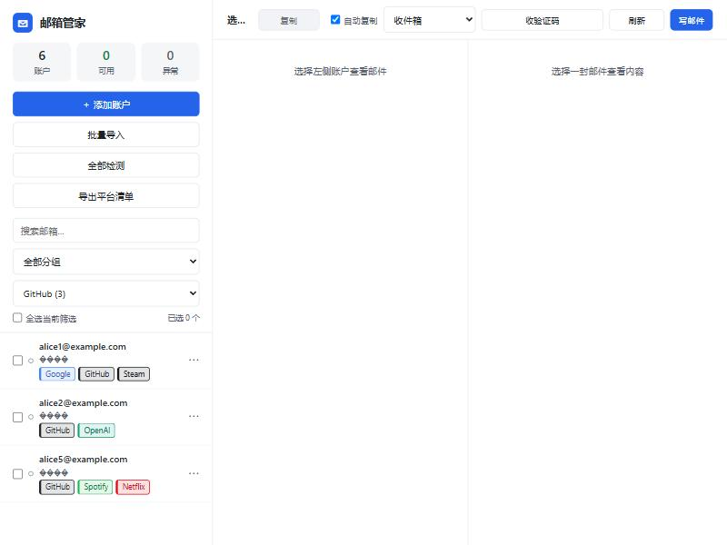

# 邮箱管家 MailDesk


一个零依赖的本地邮件管理工具：批量管 Outlook / Microsoft 账号，收信发信、批量收验证码，并标注每个邮箱注册过哪些第三方服务。

> 版本号以 [Releases 页](https://github.com/sqcola/maildesk-keysdesk/releases) 为准。

<p align="center">
  
</p>

---

## 快速开始

### 1. 环境要求

只需要 **Node.js 18 或更高版本**（[下载](https://nodejs.org/)）。不需要 `npm install`，没有任何依赖包。

检查版本：

```
node --version
```

### 2. 启动

双击 `start.bat`，或在命令行运行：

```
node server.js
```

终端会打印地址，浏览器打开它即可。

### 3. 首次授权

首次启动会生成一个本机授权码，存在 `~/.maildesk/handshake`。页面会提示你把它粘贴进去。

这一步是为了挡住**同一台电脑上的其他进程和其他 Windows 账户**——不是防网络攻击（服务只监听 `127.0.0.1`）。详见下面的[本机鉴权模型](#本机鉴权模型)。

---

## 为什么重写而不是改原来那个

原来的 `邮箱管家.exe` 静态分析后确认**没有后门**，但有几个产品级缺陷会直接导致凭据泄露：

| 原版问题 | 本工具的修正 |
|---|---|
| 邮件正文未转义就进 `innerHTML`，收到一封恶意 HTML 邮件即可窃取全部凭据 | 所有文本强制 `esc()` 转义；HTML 邮件放进 `sandbox` iframe，脚本无法执行 |
| 凭据明文存浏览器 localStorage | AES-256-GCM 加密落盘，密钥文件 `vault.key` 权限 0600 |
| CORS `Access-Control-Allow-Origin: *`，任意网页可调用本地 API | 只允许本端口来源，非法 Origin 直接不发 CORS 头 |
| 本地 API 无认证 | 见下面「本机鉴权模型」——握手需要本机秘密换 cookie，且 `vault.key` / `accounts.enc` 的 ACL 收到只有当前用户 |
| IMAP `CERT_NONE` 关闭证书校验，可被中间人 | 全部 TLS 严格校验，代码里**不存在** `rejectUnauthorized: false` |
| 依赖 jsDelivr CDN（无 SRI，且有 CVE） | **零第三方依赖**，全部资源本地 |

### 本机鉴权模型

**这一层防的是"同一台电脑上的另一个进程或另一个 Windows 账户"，不是网络攻击。**

服务只监听 `127.0.0.1`，外部网络访问不到。但本机上的其他程序（以及本机其他
已登录的 Windows 账户）可以直接连 `127.0.0.1:2131`。只靠一个"所有接口都校验"
的随机 token 挡不住它们——token 是通过 `/api?action=handshake` 无条件下发的。

现在有三道：

1. **握手需要本机秘密**。首次启动生成 `~/.maildesk/handshake`（256 位随机），
   浏览器必须在页面里粘贴它才能换到会话 cookie。别的进程读不到这个文件
   （ACL 已收到只有当前用户），也过不了 `Sec-Fetch-Site: same-origin` 校验。
   cookie 存的是秘密的 HMAC 而不是秘密本身，并且是 `HttpOnly; SameSite=Strict`。
2. **密钥文件收紧到只有当前用户**。`vault.key` 和 `accounts.enc` 的 ACL 会
   在启动时用 `icacls` 去掉继承、只授权当前账户。否则第二个管理员账户能同时
   读到密钥和密文，完全绕过第 1 道。
3. **刷新令牌加密落盘 + AAD 绑定**。每条账号的密文都用 `maildesk/2|<accountId>`
   做 AAD，把密文从 A 账号搬到 B 账号的位置会认证失败，而不是解出一份错数据。
   老的 v1 文件仍然可读，下次保存时自动升级。

**仍然挡不住的**：能读你进程内存或键盘的程序（infostealer）、以你的账户运行的
恶意软件。那种情况下加密和 ACL 都无效——它已经是你了。本机 Windows 账户之间
的隔离依赖操作系统的 ACL，如果你把 `~/.maildesk` 整个目录的权限改松了，第 2 道就失效。

---

## 添加账户需要什么

**微软已全面禁用 Outlook 的密码登录**（IMAP 基本认证）。用密码一定失败，所以本工具只支持：

- `client_id`（你注册的 Azure 应用 ID）
- `refresh_token`（刷新令牌）

### 批量导入格式

每行一个账户，支持四种分隔符（`----`、`|`、逗号、制表符）：

```
a@outlook.com----xxxxxxxx-xxxx-xxxx-xxxx-xxxxxxxxxxxx----M.C5xxxxx...
b@outlook.com | xxxxxxxx-xxxx-xxxx-xxxx-xxxxxxxxxxxx | M.C5xxxxx...
```

以 `#` 开头的行会被忽略。

四列格式也能识别，**列顺序无关**：

```
邮箱----密码----client_id(GUID)----refresh_token(M.C...)
```

工具按内容判断而不是按位置：`client_id` 是 GUID 形状，`refresh_token` 是最长的那段
（通常 400+ 字符、以 `M.C` 开头），剩下的短串当密码存。这样即使列顺序被调换也不会导入错。

> 早先的版本按位置取列，把四列格式的密码当成 `client_id`、把 `client_id` 当成
> `refresh_token`，导致每个账号都报 `AADSTS7000012` / `AADSTS9002313`。
> 如果你看到这两个错误，先确认导入的是不是四列格式。

---

## 遇到 AADSTS 错误怎么办

`refresh_token` 必须用**签发它的那个端点**去兑换。批量来的账号来源不同，端点是不同的：

| 端点 | 用于 | 地址 |
|---|---|---|
| `consumers` | 纯个人号（@outlook.com / @hotmail.com） | login.microsoftonline.com/consumers |
| `common` | 通用 | login.microsoftonline.com/common |
| `organizations` | 企业 / 学校号 | login.microsoftonline.com/organizations |
| `live` | 旧版 MSA token | login.live.com/oauth20_token.srf |

**工具默认会自动探测**：依次试 4 个端点，命中就记住，后续操作直接复用。

个人号（`@outlook.com` / `@hotmail.com`）**用 `consumers` 或 `common` 都可以**，这是实测确认的。

常见错误的含义：

| 错误码 | 含义 | 处理 |
|---|---|---|
| `AADSTS7000012` | 兑换请求用的授权机构与签发该授权的机构不一致 | 先确认导入列没取错（见上文"批量导入格式"）；正常情况下个人号不该出现 |
| `AADSTS9002313` | 通用的"请求非法或畸形" | 微软官方文档里没有这个码；实际是畸形凭据在 `/common`、`/organizations` 上的兜底报错 |
| `AADSTS40016` | 身份提供方返回错误 | 个人号用 consumers，企业号填 tenant |
| `AADSTS700016` | 该目录里找不到这个应用 | `client_id` 不存在，或这个 app 没在你请求的那个租户里注册 |
| `AADSTS70000` | token 已失效 | 重新获取 token |
| `AADSTS700082` | token 已过期（长时间未使用） | 重新获取 token |
| `AADSTS50173` | 会话过期 | 重新授权 |
| `AADSTS65001` | 没有该 (应用, 用户, 资源) 的授权记录 | 个人号打 `/organizations` 就是这个错，属正常现象，不是"需要管理员同意" |
| `AADSTS9002332` | 这个应用只允许组织账号，不该打 `/consumers` | 换 `/organizations` 或租户端点 |

> **实测记录**：同一批账号通常共用同一个 `client_id`（同一个 Azure 应用签发），
> `refresh_token` 是 481 字符的 `M.C...`。用正确的列去请求 `/consumers`，
> HTTP 200 直接拿到 access_token。之前所有 `AADSTS7000012` 都是导入列错位造成的假象。

### 端点选择：固定用 `consumers`

`/consumers` 和 `/common` 背后是同一套令牌服务，个人号两边都能用。
**推荐固定 `/consumers`**，理由：

- 它只服务个人号，语义明确。万一误喂进来一个企业号，会得到干净的 `AADSTS9002332`，
  而不是悄悄拿一个你根本不认识的租户的 token
- `/common` 会按账号类型二次路由，行为依赖登录的是谁

`/consumers` 实际上就是 `login.live.com` 的代理入口——微软自己就是 302 过去的。
所以用 `/consumers` 等价于用新版地址访问同一套后端，**不必也不建议直接用
`login.live.com/oauth20_token.srf`**：那是旧接口，已废弃，没有文档、没有 SLA、
绕开了所有条件访问策略，而且它不校验 scope 参数（传错了也给你 `invalid_grant`，
排查时毫无线索）。

个人号打 `/organizations` 必定 `AADSTS65001`，这不是权限问题，**加管理员同意也修不好**
——因为个人号压根不在任何组织租户里。看到这个组合就判断为"端点用错了"。

### refresh_token 的轮换与失效

微软在每次成功刷新后签发一个新的 refresh_token。实测要点：

- **旧 token 不会立即作废**，有一段宽限期内仍可用（我们实测连刷三次，最初的旧值仍能换到 token）。
  不要依赖这个宽限期，但它意味着"刷新后没来得及落盘"不会当场毁掉账号
- **仍然必须把新 token 写回账户库**。宽限期会过去，而且如果别处也在刷新同一批 token，
  谁先刷谁拿到新值，另一方最终会失效
- 工具现在强制要求：没有接好持久化回调就**拒绝刷新**——宁可报错，也不做静默销毁凭据的操作

> **无法从错误码判断是否有第三方在同时使用同一批 token。** 之前我在这里写过
> "看到大量 `AADSTS700082` 说明有人在同时用"——这个推论不成立，`700082` 的意思是
> "token 因长期未使用而过期"，和并发刷新无关。目前没有任何客户端可见的信号能
> 证明第三方在刷新同一批 token。能做的是：如果某天账号成片失效、且拿原始
> `refresh_token` 重新兑换也失败，那说明这份凭据已经不在你手里了。

---

## 功能

- **账户管理**：添加、批量导入、分组、搜索、删除、复制邮箱、一键诊断
- **平台账号标注**：标出每个邮箱注册过哪些第三方服务（内置 17 个 + 自定义），可按平台筛选、批量配置、导出清单
- **可用性检测**：单个或批量检测令牌是否有效、账号是否被封
- **收信**：查看收件箱/垃圾箱/已发送等文件夹，阅读邮件正文
- **发信**：通过 SMTP + XOAUTH2 发送纯文本邮件
- **批量收验证码**：多选账户一次扫完，进度条 + 可取消，结果按账户分组展示
- **验证码历史**：扫描结果自动加密落盘，关页面/重启后仍在，可标记已用、可按账户或关键词检索、可导出为文本
- **加密存储**：所有敏感凭据加密后存本地

---

## 平台账号标注

每个邮箱可以标注它注册过哪些第三方服务。用途有两个：**按平台找邮箱**（某平台要改密码时，
先找出哪些邮箱绑了它）、**导出清单**（离线存档或交接）。

### 录入

点开账户 → 「平台账号」栏 → 「＋ 添加平台」。

内置 17 个：Google、GitHub、Microsoft、Apple、Steam、Discord、Telegram、X / Twitter、
Facebook、Reddit、Twitch、Netflix、Spotify、Amazon、PayPal、OpenAI、Anthropic。
找不到就输名字，什么都能加（`Vercel`、`我的博客`、`ChatGPT Plus`）。

**自定义平台名保留你输入的原样大小写**。内部存两份：小写 key 用于筛选去重，
原始写法用于显示——不然输入 `Vercel` 会显示成 `vercel`，看着像 bug。

### 批量配置

侧栏勾选多个账户 → 「标注平台」→ 选 **加上 / 去掉 / 改为** 三种模式之一。

批量配置走一次 `upsertMany` 而不是循环写库。后者是 O(N²)（每次写都全库加解密），
100 个账户会卡死几十秒；现在 50 个账户批量设置实测 31ms。

### 筛选

侧栏「全部平台」下拉显示计数，如 `GitHub (5)`。与搜索框、分组下拉是**与**关系。

### 导出

侧栏「导出平台清单」生成 CSV：

```
邮箱,标签,分组,平台,平台数量
alice@outlook.com,,默认,GitHub; Vercel,2
```

UTF-8 带 BOM，Excel 双击不乱码。平台之间用 `; ` 而不是逗号，避免和 CSV 分隔符打架；
字段含逗号/引号/换行时按 RFC 4180 转义。

**导出只含元数据，绝不含任何凭据**——`refresh_token` / `client_id` 一个都不会出现在里面。

### 一个实现细节：颜色对比度

17 个平台品牌色差别很大（GitHub 近黑、Twitch 紫、Amazon 橙）。配色不是手填的，
而是从品牌色出发**逐步加深直到对底色达到 4.6:1**。实测最差 Netflix 4.60、
边框最差 Microsoft 3.10，全部满足 WCAG 1.4.3（文字 4.5:1）和 1.4.11（非文本 3:1）。

---

## 验证码历史

每次批量扫描完成后，识别出的验证码会自动写入 `data/history.enc`。断开页面、重启服务都不丢。

**只存 8 个字段**：`accountId` / `accountEmail` / `code` / `senderDomain` / `receivedAt` / `usedAt` / `confidence` / `id`。

> 为什么**不存**邮件主题、发件人显示名、正文：这些是发件人完全可控的内容。
> 一旦持久化，一封今天收到的恶意邮件会在三个月后仍被渲染进 DOM——把一次性注入
> 升级成存储型注入，任何未来引入的转义遗漏都会追溯性影响全部历史数据。
> 存得越少，被再次渲染的攻击面就越小。

其他约束：
- 整份文件用账户库同一把密钥做 AES-256-GCM 加密，**磁盘上没有明文验证码**
- `id = sha1(accountId:uid:code)`，同一封邮件扫 10 次只记 1 条
- 上限 2000 条 / 7 天，超出的自动裁剪
- 字段写入前逐个过白名单正则，不合规的**丢弃并计数**，不会中断整批

---

## 批量收验证码

侧栏勾选多个账户 → 点「收验证码」→ 看进度 → 结果按账户分组列出。

**性能**：单账户约 5-10 秒（含 token 刷新 + TLS 握手 + 抓取），并发固定 3。
10 个账户约 25 秒，100 个约 4 分钟。

> 并发为什么不设更高：实测并发 9 时总时长只从 188 秒降到 175 秒（-7%），
> 但单账户延迟从 5.6 秒涨到 15.8 秒（+180%）。瓶颈在微软侧限流，不在本地。
> 瓶颈在微软侧的速率限制，所以并发硬编码 3，不开放给前端调。
> 调高只会让每个账号都变慢（实测并发 9 时单账户延迟从 5.6 秒涨到 15.8 秒），
> 总时长几乎不降。

**安全设计（这几条不是可选项）**：

- 结果**按账户分组**，组内按 IMAP UID 降序，**绝不跨账户按时间排序**。
  邮件 `Date:` 头是发件人完全可控的——攻击者把它伪造成 2099 年就能让自寄的验证码
  排在最前面，用户复制粘贴就把攻击者的码提交给了平台，平台账号落到攻击者手里。
  UID 由 IMAP 服务端单调分配，不可伪造。
- 每条结果**强制显示完整邮箱**和**发件人域名**（域名最后两级加粗、不省略），
  这是用户发现「域名不对」的唯一线索。
- **没有「全部复制」按钮，聚合路径不自动复制**。逐行手动点击是唯一复制方式。
- 结果板打开期间，单账户的「自动复制」会被强制关闭，避免静默覆写剪贴板。

**退出时不会毁账号**：微软的 refresh_token 每次刷新会轮换，旧值立即作废。
所以 Ctrl+C / 关窗口 / 崩溃时，服务会先等所有在途的令牌兑换落盘（最多 15 秒）
再退出，控制台会提示「正在等待 N 个令牌兑换落盘，请勿强制关闭窗口」。
Windows 关闭控制台窗口发的是 `SIGBREAK`（不是 `SIGINT`），已一并接管。

---

## 安全设计

### 凭据保护

- 密码和 refresh_token 用 **AES-256-GCM** 加密后写入 `data/accounts.enc`
- 密钥保存在 **数据目录之外**：`~/.maildesk/vault.key`（详见下一节「密钥存放位置」）
- **磁盘上不出现任何明文凭据**（有自检用例覆盖）
- 前端永远拿不到 refresh_token，列表接口只返回前 8 位作为提示
- `.gitignore` 排除了 `data/`、`vault.key`、`.maildesk/`，避免误提交

> ⚠️ **Windows 上 chmod 无效**：`mode: 0o600` 在 Windows 会被忽略（实际是 0666），真正的保护只有 NTFS 的默认 ACL。所以**不要把项目放在同步盘或共享目录里**，`vault.key` 和 `accounts.enc` 泄露任意一个就等于泄露全部账号。

### 密钥存放位置（K2：密钥与密文分离）

早期版本把 `vault.key` 和 `accounts.enc` 一起放在 `data/` 里。问题是：**拷走整个 `data/` 文件夹就等于拿到了密钥和密文两样东西**，AES-256-GCM 的加密在此刻完全失效——一个文件夹拷贝就能带走全部账号。

现在密钥单独存放：

| 情形 | 密钥位置 |
|---|---|
| 正常启动 | `~/.maildesk/vault.key`（`C:\Users\<你>\.maildesk\vault.key`） |
| 设了 `MAILDESK_KEY_DIR` | `$MAILDESK_KEY_DIR/vault.key`（优先级最高） |
| 设了 `MAILDESK_DATA_DIR` | 仍在数据目录里（用于测试与自定义部署，保持原有语义） |

这样 `data/` 里就只剩解不开的密文，**单独拷走 `data/` 已经无法解密**。

**升级是自动的**：第一次用新版本启动时会检测旧位置（`data/vault.key`），把它搬到 `~/.maildesk/`，读回逐字节校验通过后才删除旧文件。迁移过程**绝不重写 `accounts.enc`**（密钥换、密文不换），任何一步断电都只留下"两份相同的 key"或"还没搬完"，下次启动幂等重来。

如果两处密钥**内容不同**，程序会**直接拒绝启动**并打印两条绝对路径——因为静默选用任意一个，都会让另一批数据永久无法读取。这时用 `tools/check-key.js` 判断该留哪一份：

```
node tools/check-key.js
```

它会分别用两个位置的密钥去解 `data/accounts.enc`，报告哪一处能解、能解出多少个账户。退出码：能解 = 0，都不能解 = 1。

确认 `~/.maildesk/vault.key` 可用后，可以清理数据目录里的旧副本：

```
node tools/check-key.js --purge-legacy
```

（`--purge-legacy` 带交互确认；脚本里可用 `--yes` 跳过。两份内容不同时默认拒绝删除，必须显式 `--force`——那是一把独一无二的密钥。）

### 网络防护

- 服务只绑定 `127.0.0.1`，不监听外网
- **校验 `Host` 头**必须为 `127.0.0.1:<端口>` 或 `localhost:<端口>`——这是防 DNS rebinding 的唯一手段（rebinding 下浏览器认为请求同源，根本不走 CORS 检查）
- 每次启动生成新的随机 token（64 位 hex），接口用常量时间比较校验
- CORS 白名单只含本端口来源，**绝不回退成 `*`**
- 静态文件路径严格校验，阻断 `../`、`%2e%2e`、`..\`、UNC 路径穿越
- 请求回调最外层有 try/catch + `uncaughtException` 兜底，畸形请求不会让进程退出

### 邮件渲染

- 纯文本邮件：转义后按换行渲染
- HTML 邮件：放进 `<iframe sandbox>`，即使正文含 `<script>` 也无法执行，更碰不到父页面的 token
- 所有外链带 `referrerpolicy="no-referrer"`

### TLS

- IMAP（993）和 SMTP（587 STARTTLS）全部强制严格证书校验
- 代码中不存在关闭校验的开关
- SMTP 拒绝在未加密连接上发送任何凭据

---

## 自检

```
node selftest.js        # 159 项功能用例
node security-test.js   # 64 项安全回归用例
node tools/check-key-test.js  # 27 项（v1/v2/混装库、退出码、purge）
```

`selftest.js` 覆盖：模块加载、IMAP ENVELOPE 解析（含中文/GBK）、MIME 解析（纯文本/base64/quoted-printable/multipart）、邮件构造、加密存储往返、磁盘无明文验证、错误归类、路径穿越防护、TLS 配置检查、验证码提取（16 种模板）、剪贴板实现、端点自动探测、refresh_token 轮换持久化、批量收码 job 管理器、验证码历史加密与字段校验、密钥分离（五个迁移分支全覆盖）。

其中几条是**防回归断言**，专门锁住曾经真实出过事的地方：
- `bulk-scan.js` 不得绕过 `mail.getAccessToken` —— 绕过去会跳过令牌轮换落盘，账号当场永久失效
- 从 `case 'account.check'` 到文件末尾不得出现 `vault.upsert(acc)` —— 那会用旧快照覆盖刚落盘的轮换令牌
- 历史文件路径不得含 `public` —— 会被静态托管当作资源吐出去
- 前端不得再用 `prompt` / `alert` / 原生 `confirm`

`security-test.js` 针对安全审计发现的问题逐条验证修复，会真实启动服务并发起攻击请求（畸形路径、DNS rebinding、ReDoS、命令注入等）。

---

## 安全审计结果

经过一轮独立的红队审计，发现并修复了 8 个问题：

| 编号 | 问题 | 严重度 | 修复 |
|---|---|---|---|
| H1 | `/%zz` 等畸形路径让 `decodeURIComponent` 抛异常，**进程直接退出** | 高 | 解码前 try/catch，返回 400 |
| H2 | 畸形请求行让 `new URL()` 抛异常，同样崩溃 | 高 | 整体包 try/catch + `uncaughtException` 兜底 |
| M1 | DNS rebinding 可绕过 CORS 拿到 token | 中 | 校验 `Host` 头必须为 `127.0.0.1:PORT` 或 `localhost:PORT` |
| M2 | 邮件正文大量 `<` 触发 ReDoS，打开一封邮件即冻结服务 | 中 | 手写线性扫描替换回溯正则；MIME 递归深度上限 20 层；输入上限 200KB |
| M3 | **SMTP 的 STARTTLS 从未发送 STARTTLS 命令**，发信功能实际不可用 | 中 | 先发 `STARTTLS` 等 220，再包 TLS；检查 EHLO 是否声明该能力 |
| M4 | 批量导入/检测是 O(N²) 磁盘写入，20 条就要 33 秒 | 中 | 改为内存聚合 + 单次落盘 |
| L1 | IMAP `SELECT` 未过滤 CR/LF，可注入命令 | 低 | 拒绝控制字符 + 标准 quoted-string 转义 |
| L2 | `timingSafeEqual` 用字符长度比较，多字节输入返回 500 | 低 | 改用 Buffer 字节长度 |

审计同时**逐项确认安全**的部分：认证无绕过、CORS 不回退 `*`、路径穿越防护正确（含 Windows `..\`、UNC、ADS）、零第三方依赖无命令注入、SMTP 头注入不可能（主题含 CRLF 会被 base64 编码）、前端 `esc()` 全覆盖 + sandbox iframe 无 XSS、AES-GCM 无 IV 重用且认证标签生效、TLS 无降级开关。

---

## 文件结构

```
MailDesk/
├── server.js            # HTTP 服务、API 路由、安全头、退出协调
├── start.bat            # Windows 一键启动
├── selftest.js          # 159 项功能自检
├── security-test.js     # 64 项安全回归
├── .gitignore           # 排除 data/、vault.key、.maildesk/
├── tools/
│   ├── check-key.js     # 密钥体检：判断哪份 vault.key 能解开账户库
│   └── check-key-test.js # 上述工具的 27 项测试（含 v1/v2/混装库）
├── lib/
│   ├── imap-client.js   # 自写 IMAP 客户端（TLS + XOAUTH2 + FETCH）
│   ├── smtp.js          # 自写 SMTP 客户端（STARTTLS + XOAUTH2 + 发送）
│   ├── mail.js          # 业务层：认证、收信、发信、MIME 解析、令牌轮换落盘
│   ├── code-extractor.js # 验证码提取引擎
│   ├── bulk-scan.js     # 批量收码：单账户单连接扫描
│   ├── jobs.js          # 内存 job 管理器（幂等锁 / 取消 / 在途事务计数）
│   ├── history.js       # 验证码历史（加密落盘 + 字段白名单）
│   └── vault.js         # 加密存储（密钥与密文分目录）
├── public/
│   ├── index.html
│   ├── app.js           # 前端逻辑（含 esc 转义、sandbox iframe、剪贴板）
│   └── style.css
├── data/                # 运行时生成：只有密文，没有密钥
│   ├── accounts.enc     # 账户库（AES-256-GCM）
│   └── history.enc      # 验证码历史（同一把密钥加密）
└── ~/.maildesk/         # 密钥单独存放（不在项目目录内）
    └── vault.key        # 加密密钥，权限 0600
```

---

## 注意

- 本工具**不做**任何绕过风控的事情：不加代理池、不做指纹伪造、不自动注册账号
- 微软的账号恢复表单考核的是历史信息（注册 IP、旧密码、邮件主题行等）。**不是本人注册的账号**在这一点上有结构性劣势，工具解决不了
- `refresh_token` 等于永久免密访问权，**改密码对它无效**。如果凭据来源不明，建议先在微软侧撤销授权
- 账号数据只存在本机，请定期备份 `data/` 目录**和 `~/.maildesk/vault.key`**；**丢失 `vault.key` 后加密数据无法恢复**

---

## 备份

**`data/` 已经不再是全部数据了。** 密钥现在单独放在 `~/.maildesk/vault.key`，备份时必须**两处一起备**：

1. 关闭程序
2. 复制 `data/` 到安全位置（密文）
3. 复制 `~/.maildesk/vault.key` 到安全位置（密钥）
4. 恢复时两处都放回原路径（或恢复 `data/` 后把 `vault.key` 放进 `MAILDESK_KEY_DIR` 指定的目录）

只备份 `data/` 等于备份了一堆解不开的字节；只备份 `vault.key` 则没有任何账户数据。`vault.key` 和 `accounts.enc` 必须**成对**保存，缺一个另一个就没用。

如果用的是自定义 `MAILDESK_KEY_DIR`，备份那个目录下的 `vault.key` 即可。

> 密钥分开存放也意味着**备份介质可以分开保管**：密文放网盘、密钥离线保存，任何单一介质泄露都不足以解密账户库。这也是本次改动的主要目的。

---

## ⚠️ 已知缺陷（0.1.0-SNAPSHOT）

> **0.1.0-SNAPSHOT 之后修复的**：验证码历史补上了完整界面（列表 / 筛选 / 标记 /
> 导出 / 清理）；`check-key.js` 现在能正确解开 v2 库；`accounts.enc` 与
> `history.enc` 每次写盘后都保持收紧的 ACL（不再退回继承态）；批量扫描的硬时限
> 改为按任务规模推导，不再固定 15 分钟误杀大任务。

### 1. 必须自己准备 `client_id` + `refresh_token`，工具内没有授权流程

本工具**只接受** `client_id` 和 `refresh_token`（微软已禁用密码登录），
代码里**没有任何 OAuth 授权码 / 设备码流程**。也就是说：想管自己的邮箱，
你需要先自己注册 Azure 应用、走一遍授权拿到 `refresh_token` 再粘进来。

README 里目前没有写这个流程 —— 这是已知的文档缺口。
如果你手里的 token 来源不明，先去 [account.microsoft.com](https://account.microsoft.com)
检查并撤销授权。

### 2. 只支持 Outlook / Microsoft 账号

IMAP 和 SMTP 主机名是硬编码的（`outlook.office365.com` / `smtp-mail.outlook.com`），
认证只支持 `XOAUTH2`。**Gmail、自建域名邮箱、其他 IMAP 服务商都加不进来。**
