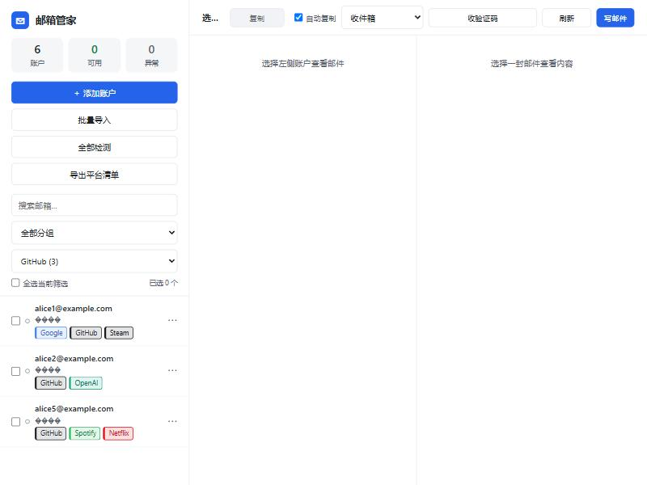

[简体中文](README.md) | English

<div align="center">

# MailDesk & KeyDesk

**Two local tools with zero dependencies**: batch-manage mailboxes, and keep their 2FA secrets and recovery codes safe


**No cloud** · **No npm install** · **Your data never leaves the machine**

**[📦 Releases](https://github.com/sqcola/maildesk-keysdesk/releases)** ·
[Quick start](#-quick-start) ·
[Report an issue](https://github.com/sqcola/maildesk-keysdesk/issues) ·
[Security policy](SECURITY.md)

> This project **ships no prebuilt binaries** — no exe, no installer. You need Node.js to run it,
> and two commands will do it. See "Quick start" below.

</div>

> ⚠️ **This is a personal tool, still in early development (0.1.0-SNAPSHOT)**
> Questions and suggestions are welcome — please [open an Issue](https://github.com/sqcola/maildesk-keysdesk/issues);
> if you find it useful, a star means a lot ⭐
>
> **The [Releases page](https://github.com/sqcola/maildesk-keysdesk/releases) is the source of truth for versions.**
> The latest verified version is `0.1.0-SNAPSHOT` (as of the last update to this document).
> This README does not maintain a version number of its own — **whenever it disagrees with the
> Releases page, the Releases page wins**.

## Who this is for / who it is not for

**MailDesk is for** people who hold dozens to a couple hundred Microsoft accounts and need to do
"import → check which are alive → collect verification codes → record which services each account
signed up for" in one interface.

⚠️ One prerequisite: it **only accepts `client_id` + `refresh_token`**. There is no built-in OAuth
login flow. To manage your own mailbox you have to walk through authorization yourself first to get
a token.

**KeyDesk is for** single-machine users who want TOTP secrets and recovery codes in one locally
encrypted vault, and who care about details like "which generation were these recovery codes, and
how many have I used".

**Neither is for:**

| Your situation | What you want instead |
|---|---|
| One or two mailboxes of your own, just send and receive | Thunderbird / whatever mail client ships with your OS |
| Checking codes on your phone throughout the day | Aegis (Android) / Kaisa or 2FAS (iOS) / Bitwarden |
| Syncing across devices | Bitwarden / 1Password |
| Browser autofill | KeePassXC / Bitwarden |
| Team sharing, audit logs, offboarding | A commercial password manager — this project has no concept of users |

The table is up front because **it answers "should I keep reading" better than any feature list could**.

<p align="center">
  
</p>

---

## ✨ Features

**MailDesk — mailbox management**

- **Batch import** — columns are identified by content (`client_id` looks like a GUID, `refresh_token` is the longest), not by position; four-column and three-column exports, mixed, all import fine
- **Liveness checks** — single or batch, and it distinguishes "token expired" from "account banned"; the latter is not retried
- **Read / send mail** — IMAP inbox (including Junk and Sent), plain-text sending over SMTP
- **Batch code collection** — select many accounts and scan them in one pass, with a progress bar you can cancel; results are grouped by account
- **Code history** — scan results are written to disk encrypted, so closing the page or restarting loses nothing; mark codes as used, search by account, export
- **Platform tags** — record which services each mailbox has signed up for (17 built in, plus any custom names), filter by platform, configure in bulk, export CSV

**KeyDesk — 2FA management**

- **Normal TOTP display is computed server-side** — the 6-digit codes in the list and detail views are calculated on the server; the page gets the code, never the secret. ⚠️ But **clicking "show secret" or "QR code" puts the plaintext secret into browser memory** — that is unavoidable, because the page has to assemble an otpauth URI. Which means CSP and the same-origin policy are the only boundary on those two paths, and an XSS can reach it
- **Recovery-code generations** — knows which batch came from which generation, and lets you mark individual codes as used with the date
- **Two-slot unlock** — passphrase *or* recovery key, so a forgotten passphrase is not permanent lockout
- **Mandatory retype** — after first-time setup you must re-enter segments 2, 5 and 7 of the recovery key to get in; copy it wrong and you don't
- **Encrypted export** — separate salt and IV, domain-separated AAD; the export can't be used as the main vault
- **Audit view** — see at a glance which accounts lack 2FA, lack recovery codes, or have stale recovery codes

**Shared**

- **Zero third-party dependencies** — no `package.json`, no `node_modules`. Both the QR encoder (Reed-Solomon included) and TOTP are implemented here
- **Threat models written down** — each tool states plainly what it does and does not protect against, with no overselling

## 🚀 Quick start

Requires [Node.js](https://nodejs.org/) **18+**. No `npm install`.

```bash
git clone https://github.com/sqcola/maildesk-keysdesk.git
cd maildesk-keysdesk
```

**Start MailDesk:**

```bash
cd MailDesk && node server.js
```

On Windows you can also just double-click `start.bat`. The first launch generates a local auth code
at `~/.maildesk/handshake` and the page asks you to paste it in — that step exists to keep out
**other processes on the same machine and other Windows accounts**, not to stop attacks over the
network (the server only listens on `127.0.0.1`).

**Start KeyDesk:**

```bash
cd KeyDesk && node server.js
```

The first use asks you to set a master passphrase, **and forces you to retype segments 2, 5 and 7 of
the recovery key**. This is not busywork: once you dismiss the recovery key you can never view it
again, and discovering three months later, at the moment you actually need to recover, that you
never wrote it down leaves you with nothing to fall back on.

## ❓ FAQ

| Question | Answer |
|---|---|
| It asks me to paste an auth code on first launch — where do I find it? | `~/.maildesk/handshake` (on Windows, `C:\Users\<your-username>\.maildesk\handshake`). Open it in Notepad and copy the whole 64-character line. You only do this once |
| I pasted the auth code and still can't get in | Usually stray whitespace or a missing character from the copy — the code is a full line of 64 hex characters with nothing before or after it. **Note: this file is persistent; restarting the service does not change it** (unless you delete it yourself). If it genuinely doesn't match, delete `~/.maildesk/handshake` and restart the service to generate a new one |
| Moving to another browser, or between `localhost` and `127.0.0.1`, makes me authorize again | Expected. The auth cookie is stored per hostname, and to a browser `localhost` and `127.0.0.1` are two different sites. Pick one address and stick to it |
| MailDesk reports `AADSTS7000012` | Columns got misaligned on import. `client_id` has the shape of a GUID and `refresh_token` is the longest field, and the tool decides by content — but oddly formatted files still need a manual check |
| MailDesk reports `AADSTS9002313` | A `refresh_token` must be redeemed against **the endpoint that issued it** (`consumers` / `organizations` / `common` are not interchangeable) |
| I forgot the KeyDesk passphrase | Unlock with the recovery key, then go straight to settings, change the passphrase, and generate a fresh recovery key |
| I forgot both / lost both | The data is permanently unreadable. **No backdoor, no recovery path** — that is the design, not a limitation |
| Can I keep it on a cloud drive to sync? | **KeyDesk: yes.** The ciphertext is safe anywhere (the key is derived from the passphrase, there is no key file). But after you change the passphrase, older versions still sitting in the cloud's version history can be opened with the old one — clean those up by hand.<br>**MailDesk: no.** It has a separate key file, `~/.maildesk/vault.key`, which must be kept apart from `data/accounts.enc`; if both leak together, every account is compromised. **Do not put the MailDesk directory in a synced folder.** |
| Can I run it on several devices at once? | No. Two instances writing the same vault overwrite each other and can corrupt the file.<br>**Both MailDesk and KeyDesk now have an instance lock**: when one is already running, the second refuses to start and tells you to shut the running one down first, instead of falling through to the next port and starting anyway. |

## 🔧 How it works

**MailDesk**

```
Browser (127.0.0.1:2131)
   │  HTTP + Bearer token (handshake: local secret -> session cookie)
   ▼
Node.js server (zero dependencies)
   ├─ IMAP client  ──TLS──> outlook.office365.com
   ├─ SMTP client  ──TLS──> smtp-mail.outlook.com
   └─ Vault        ──AES-256-GCM──> data/accounts.enc
                                    + ~/.maildesk/vault.key
```

**KeyDesk**

```
Browser (127.0.0.1:2151)
   │  HTTP + Bearer token
   ▼
Node.js server (zero dependencies)
   └─ scrypt(passphrase) ──> KEK ──AES-256-GCM──> DEK ──> data/vault.enc
                             ↑                    ↑
                             │                    └─ passphrase change keeps the same DEK,
                             └─ two slots:           so the recovery slot still works
                                passphrase / recovery key
```

### Tech stack

| Layer | What it uses |
|---|---|
| Server | Node.js 18+, **built-in modules only** (`http` / `crypto` / `net` / `tls` / `fs`) |
| Front end | Plain JS + CSS, no framework, no build step |
| Crypto | `aes-256-gcm` (96-bit random IV, AAD domain separation), `scrypt` (N=32768, r=8, p=1) |
| Protocols | IMAP4rev1 + XOAUTH2, SMTP + STARTTLS |
| TOTP | Hand-written, passes all 18 official RFC 6238 vectors |
| QR | Hand-written: byte mode v1-10, ECC M, Reed-Solomon, mask penalty scoring |
| Tests | Hand-rolled assertion harness, 575 assertions |

<details>
<summary><b>Design note 1: why the handshake needs a local secret</b></summary>

The server only listens on `127.0.0.1`, so it is unreachable from the network. But **other programs
on this machine, and other signed-in Windows accounts on this machine**, can connect to that port
directly. A random token that every endpoint validates does not stop them — if the token is handed
out unconditionally, the door was never closed.

So there are three layers (**the same three for both MailDesk and KeyDesk**):

1. **The handshake requires a local secret** — first launch generates a 256-bit random string.
   MailDesk puts it at `~/.maildesk/handshake` (your home directory, which only you can read by
   default); KeyDesk puts it at `<repo>/KeyDesk/data/handshake` (it follows the data directory, which
   `KEYDESK_DATA_DIR` can move). The browser has to paste it in before it gets a session cookie.
   Other ordinary processes cannot read that file, and they also fail the
   `Sec-Fetch-Site: same-origin` check. The cookie stores an HMAC of the secret, not the secret
   itself. Note that KeyDesk's copy lives inside the repository, so this layer only holds if the
   repository directory itself is not readable by other accounts — see `KeyDesk/README.md`
2. **Key files get tightened ACLs** — after every write, `vault.key` / `accounts.enc` / `vault.enc`
   go through `icacls` to strip inheritance and grant only the current account. Otherwise a second
   admin account can read both key and ciphertext and walk straight around layer 1
3. **AAD binds the record to its ID** — every MailDesk account is encrypted with
   `maildesk/2|<accountId>` as its AAD, so moving a ciphertext from account A's slot to account B's
   fails authentication

</details>

<details>
<summary><b>Design note 2: why the two tools are not merged</b></summary>

`refresh_token` and TOTP secrets have completely different security properties:

- A `refresh_token` **can be re-imported**. Lose it and you redo authorization for a new one;
  Microsoft's token rotation only invalidates the old value
- A TOTP secret **cannot be rotated**. Lose it and that account's second factor is gone for good

Putting them in one vault would make "the mailbox vault leaked" and "the 2FA vault leaked" the same
event. They deserve different backup strategies, different passphrases, and different exposure.

</details>

<details>
<summary><b>Design note 3: why changing the passphrase does not rotate the DEK</b></summary>

Rotating the DEK would mean re-wrapping the recovery slot with the recovery key — and a "change my
passphrase" action has no access to the recovery key. The inevitable outcome: **the recovery slot's
ciphertext now wraps a DEK that can never be unwrapped again, and the user believes the escape hatch
is still there when it is already gone.**

So we keep the DEK and get forward secrecy from "delete every `.bak.N` after a passphrase change" —
those backups wrap the old KEK around the same DEK, so leaving them behind means the old passphrase
still works.

The cost is losing the ability to roll back to the previous version. That trade-off is written up in
`KeyDesk/README.md`.

</details>

## 📌 Current status

> Last updated: 2026-11-18. For version numbers, the [Releases page](https://github.com/sqcola/maildesk-keysdesk/releases) is authoritative.

| Module | Status |
|---|---|
| MailDesk core: import / checks / send & receive / batch code collection | ✅ Done |
| MailDesk platform tags: 17 built in + custom + filter + bulk + export | ✅ Done |
| MailDesk security: handshake auth, ACL tightening, AAD binding, instance lock | ✅ Done |
| KeyDesk core: TOTP / recovery-code generations / two-slot unlock | ✅ Done |
| KeyDesk security: mandatory retype, encrypted export, audit view | ✅ Done |
| Test suites: 5 suites, 575 assertions | ✅ All green |
| `1.0.0` (promote after long-term validation on real data) | ⬜ Waiting on 0.1.x settling down |

**Quality baseline**: 5 suites (`selftest` + `security-test` + `check-key-test`) all green · a
100-account mail vault with zero damage · every critical security fix pinned by an assertion (we did
mutation testing during development, but there is no re-runnable mutation test script in the repo)

## 📦 Running

No build step. Just run it:

```bash
# MailDesk (port 2131 by default)
cd MailDesk && node server.js

# KeyDesk (port 2151 by default)
cd KeyDesk && node server.js
```

The port ranges are fixed — MailDesk falls through 2131-2140 and KeyDesk through 2151-2160, and the
two ranges deliberately do not overlap.

## 🤝 Development and contributing

A personal project. The code isn't pretty, but every security fix is pinned by an assertion. Issues
and PRs are welcome.

- **Contributing guide**: [`CONTRIBUTING.md`](CONTRIBUTING.md) — how to report a problem, how to send a PR, code style and test requirements
- **Running the tests**:
  ```bash
  cd MailDesk && node selftest.js && node security-test.js && node tools/check-key-test.js  # 159 + 64 + 27
  cd ../KeyDesk && node selftest.js && node security-test.js  # 241 + 84
  ```
- **Issues and PRs**: when reporting a bug, include **the version of the tool that broke**, your OS, your Node version, and reproduction steps;
  if you want to change code, open an Issue first so the work isn't wasted

## 📚 Documentation

| Document | Contents |
|---|---|
| [`MailDesk/README.md`](MailDesk/README.md) | Import format, AADSTS troubleshooting, how batch code collection works, the local auth model |
| [`KeyDesk/README.md`](KeyDesk/README.md) | Threat model, KDF parameter choices, recovery-key design, the boundaries of cloud drives and rollback |
| [`SECURITY.md`](SECURITY.md) | Vulnerability reporting channel, response times, **known boundaries that are out of scope** |
| [`CONTRIBUTING.md`](CONTRIBUTING.md) | Environment, tests, code conventions, PR flow |
| [Releases](https://github.com/sqcola/maildesk-keysdesk/releases) | Release notes |

## ⚠️ Scope of use

**This tool assumes you have a lawful right to use the mailboxes you point it at.**

- It does **not** do anything to evade platform abuse controls: no proxy pools, no fingerprint
  spoofing, no automated account registration, and no SMS/verification-code receiving service.
- It does **not** change what the Microsoft Services Agreement requires of you. MSA §4.a.i prohibits
  transferring account credentials; §3.a.v prohibits creating fake accounts and automated inauthentic
  activity. Using this tool does not exempt you from those terms, nor does it limit Microsoft's
  right to close an account unilaterally.
- **If the `refresh_token` you have came from somewhere unclear** (bought, given to you, an
  unlabelled bulk file), go check the authorizations at
  [account.microsoft.com](https://account.microsoft.com) and consider revoking them. A
  `refresh_token` is equivalent to permanent password-free access, and changing the password does
  not invalidate it.
- **You carry the risk.** The MIT license removes the author's liability, but it grants you no
  permission beyond the rights you already hold.

## ⚖️ License and acknowledgements

Released under the [MIT](LICENSE) license.

There are no third-party dependencies, so there are no libraries to thank. The design does draw on
these public specifications and documents:

- [RFC 6238](https://www.rfc-editor.org/rfc/rfc6238) / [RFC 4226](https://www.rfc-editor.org/rfc/rfc4226) — TOTP and HOTP
- [RFC 4648](https://www.rfc-editor.org/rfc/rfc4648) — Base32
- [RFC 4180](https://www.rfc-editor.org/rfc/rfc4180) — CSV format
- [OWASP Password Storage Cheat Sheet](https://cheatsheetseries.owasp.org/cheatsheets/Password_Storage_Cheat_Sheet.html) — scrypt parameter choices
- [OWASP CSV Injection](https://owasp.org/www-community/attacks/CSV_Injection) — neutralizing formula prefixes on export

## ⭐ Star History

<a href="https://www.star-history.com/?repos=sqcola%2Fmaildesk-keysdesk&type=date&legend=top-left">
 <picture>
   <source media="(prefers-color-scheme: dark)" srcset="https://api.star-history.com/chart?repos=sqcola%2Fmaildesk-keysdesk&type=date&theme=dark&legend=top-left" />
   <source media="(prefers-color-scheme: light)" srcset="https://api.star-history.com/chart?repos=sqcola%2Fmaildesk-keysdesk&type=date&legend=top-left" />
   
 </picture>
</a>
