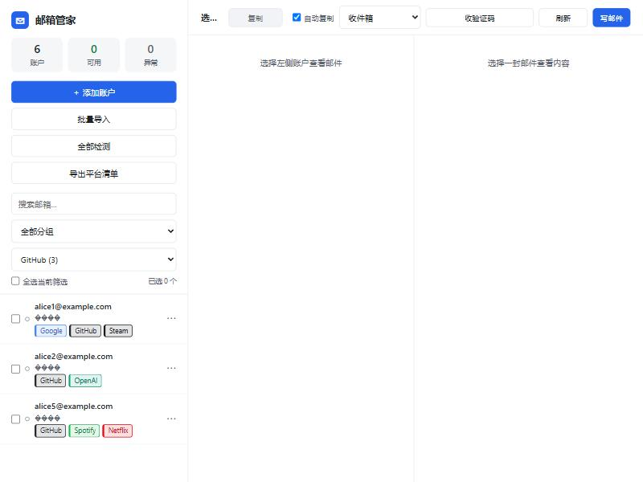

<div align="center">

# MailDesk & KeyDesk

**两个零依赖的本地工具**：批量管理邮箱，以及安全保管它们的 2FA 密钥与恢复码


**不需要云** · **不需要 npm install** · **数据不出本机**

**[⬇️ 下载最新版](https://github.com/sqcola/maildesk-keysdesk/releases)** ·
[问题反馈](https://github.com/sqcola/maildesk-keysdesk/issues) ·
[安全策略](SECURITY.md)

</div>

> ⚠️ **这是个人自用工具，处于早期开发中（0.1.0-SNAPSHOT）**
> 有任何问题、建议都欢迎提交 [Issues](https://github.com/sqcola/maildesk-keysdesk/issues)；
> 如果觉得有用就 Star 一下 ⭐
>
> **当前版本以 [Releases 页](https://github.com/sqcola/maildesk-keysdesk/releases) 为准**：
> 最新验证版本是 `0.1.0-SNAPSHOT`（截至本文最后更新）。本 README 不单独维护版本号 ——
> 与 Releases 页对不上时**一律以 Releases 页为准**。

<p align="center">
  
</p>

---

## ✨ 功能特性

**MailDesk —— 管邮箱**

- **批量导入** —— 按内容识别列（`client_id` 是 GUID、`refresh_token` 最长），不按位置；号商的四列/三列混排格式都能吃
- **可用性检测** —— 单个或批量，区分「令牌失效」和「账号被封」，后者不重试
- **收信 / 发信** —— IMAP 收件箱（含垃圾箱、已发送），SMTP 发纯文本
- **批量收验证码** —— 多选账户一次扫完，进度条 + 可取消，结果按账户分组展示
- **验证码历史** —— 扫描结果加密落盘，关页面、重启都不丢；可标记已用、按账户检索、导出
- **平台标注** —— 标出每个邮箱注册过哪些服务（内置 17 个 + 任意自定义名），按平台筛选、批量配置、导出 CSV

**KeyDesk —— 管 2FA**

- **TOTP 服务端算码** —— 密钥不进浏览器内存，连 XSS 和恶意扩展都拿不到，只能看到 6 位码
- **恢复码代际管理** —— 记得清哪一批是哪次生成的，逐码标记已用并显示日期
- **双槽解锁** —— 口令 或 恢复密钥，忘了口令不会永久失锁
- **强制回填** —— 首次设置后必须回填恢复密钥的第 2/5/7 段才能进入，抄错进不去
- **加密导出** —— 独立盐和 IV，域分离 AAD，导出包不能当主库用
- **审计视图** —— 一眼看出哪些账号缺 2FA、缺恢复码、恢复码过期

**共同**

- **零第三方依赖** —— 没有 `package.json`，没有 `node_modules`。QR 编码（含 Reed-Solomon）与 TOTP 均为自实现
- **威胁模型写在文档里** —— 每个工具都明确列出「能防什么、防不住什么」，不夸大

## 🚀 快速开始

需要 [Node.js](https://nodejs.org/) **18+**。不需要 `npm install`。

```bash
git clone https://github.com/sqcola/maildesk-keysdesk.git
cd maildesk-keysdesk
```

**启动 MailDesk：**

```bash
cd MailDesk && node server.js
```

Windows 上也可以直接双击 `start.bat`。首次启动会生成一个本机授权码存在 `~/.maildesk/handshake`，
页面会提示你粘贴进去——这一步是为了挡住**同一台电脑上的其他进程和其他 Windows 账户**，
不是防网络攻击（服务只监听 `127.0.0.1`）。

**启动 KeyDesk：**

```bash
cd KeyDesk && node server.js
```

首次使用会让你设一个主口令，**并强制回填恢复密钥的第 2、5、7 段**。
这不是刁难：恢复密钥关闭后无法再查看，三个月后真要恢复时才发现没抄，那时已经没有任何补救办法。

## ❓ 常见问题

| 问题 | 解法 |
|---|---|
| 首次打开让我粘贴授权码，去哪找？ | `~/.maildesk/handshake`（Windows 上是 `C:\Users\你的用户名\.maildesk\handshake`），用记事本打开，整行 64 位字符复制过来。只需做一次 |
| 授权码贴了还是进不去 | 那个文件已经变了（服务重启过会重新生成）。重新打开文件复制当前内容 |
| MailDesk 报 `AADSTS7000012` | 导入时列错位了。`client_id` 是 GUID 形状、`refresh_token` 最长，工具按内容判断，但格式太怪时仍需手工核对 |
| MailDesk 报 `AADSTS9002313` | `refresh_token` 必须用**签发它的那个端点**去兑换（`consumers` / `organizations` / `common` 不能混用） |
| KeyDesk 忘了口令怎么办 | 用恢复密钥解锁，然后立刻去设置里改口令并重新生成恢复密钥 |
| 两个都忘了 / 都丢了 | 数据永久不可读。**没有后门，没有找回途径**——这是设计，不是限制 |
| 能不能放网盘同步 | 可以。密文放哪都安全（密钥从口令派生，没有密钥文件）。但**改口令后云盘的历史版本仍可用旧口令解开**，需手动清理 |
| 能不能多设备同时用 | 不能。两个实例写同一份库会互相覆盖，MailDesk 已加实例锁直接拒绝启动 |

## 🔧 它是怎么工作的

**MailDesk**

```
浏览器 (127.0.0.1:2131)
   │  HTTP + Bearer token（握手用本机 secret 换 cookie）
   ▼
Node.js 服务（零依赖）
   ├─ IMAP 库  ──TLS──> outlook.office365.com
   ├─ SMTP 库  ──TLS──> smtp-mail.outlook.com
   └─ Vault   ──AES-256-GCM──> data/accounts.enc
                                ＋ ~/.maildesk/vault.key
```

**KeyDesk**

```
浏览器 (127.0.0.1:2151)
   │  HTTP + Bearer token
   ▼
Node.js 服务（零依赖）
   └─ scrypt(口令) ──> KEK ──AES-256-GCM──> DEK ──> data/vault.enc
                        ↑                    ↑
                   双槽：口令 / 恢复密钥   改口令不换 DEK，保住恢复槽
```

### 技术栈

| 层 | 用了什么 |
|---|---|
| 服务端 | Node.js 18+，**只用内置模块**（`http` / `crypto` / `net` / `tls` / `fs`） |
| 前端 | 原生 JS + CSS，无框架、无构建步骤 |
| 加密 | `aes-256-gcm`（96 位随机 IV，AAD 域分离）、`scrypt`（N=32768, r=8, p=1） |
| 协议 | IMAP4rev1 + XOAUTH2、SMTP + STARTTLS |
| TOTP | 自实现，通过 RFC 6238 全部 18 个官方向量 |
| QR | 自实现，字节模式 v1-10 / ECC M / Reed-Solomon / 掩码惩罚 |
| 测试 | 自制断言器，498 条，含变异测试 |

<details>
<summary><b>关键设计一：为什么 MailDesk 的握手要本机秘密</b></summary>

服务只监听 `127.0.0.1`，外部网络访问不到。但**本机上的其他程序、以及本机其他已登录的
Windows 账户**可以直接连这个端口。只靠一个"所有接口都校验"的随机 token 挡不住它们——
token 本来就是通过 `/api?action=handshake` 无条件下发的。

所以有三道：

1. **握手需要本机秘密** —— 首次启动生成 `~/.maildesk/handshake`（256 位随机），
   浏览器必须粘贴它才能换到会话 cookie。别的进程读不到这个文件，也过不了
   `Sec-Fetch-Site: same-origin` 校验。cookie 存的是秘密的 HMAC 而不是秘密本身
2. **密钥文件收紧 ACL** —— `vault.key` 和 `accounts.enc` 在启动时用 `icacls` 去掉继承、
   只授权当前账户。否则第二个管理员账户能同时读到密钥和密文，完全绕过第 1 道
3. **AAD 绑定账户 ID** —— 每条账号的密文都用 `maildesk/2|<accountId>` 做 AAD，
   把密文从 A 账号搬到 B 账号的位置会认证失败

</details>

<details>
<summary><b>关键设计二：为什么两个工具不合并</b></summary>

`refresh_token` 和 TOTP 密钥的安全属性完全不同：

- `refresh_token` **可以重新导入**。丢了就重新从号商拿一份，微软的 token 轮换只是让旧值失效
- TOTP 密钥**不可轮换**。丢了就是永久失去那个账号的第二因素

放同一个库里，意味着"邮箱库泄露"和"2FA 库泄露"变成同一件事。它们本来就该有不同的
备份策略、不同的口令、不同的暴露面。

</details>

<details>
<summary><b>关键设计三：为什么改口令不换 DEK</b></summary>

换了 DEK 就必须用恢复密钥重新包裹恢复槽，而"改口令"这个动作拿不到恢复密钥。
硬换的结果是：**恢复槽的密文变成一把再也解不开的 DEK，用户以为还有逃生门，实际已经没了。**

所以选择不换 DEK，靠"改口令后删除全部 `.bak.N`"来保证前向安全——
那些备份里裹的是旧 KEK + 同一个 DEK，留着它们就等于旧口令仍然有效。

代价是失去"回退到上一版"的能力。这个取舍写在 `KeyDesk/README.md` 里。

</details>

## 📌 当前进度

> 最后更新：2026-11-18。版本号以 [Releases 页](https://github.com/sqcola/maildesk-keysdesk/releases) 为准。

| 模块 | 状态 |
|---|---|
| MailDesk 核心：导入 / 检测 / 收发信 / 批量收码 | ✅ 完成 |
| MailDesk 平台标注：17 内置 + 自定义 + 筛选 + 批量 + 导出 | ✅ 完成 |
| MailDesk 安全：握手鉴权、ACL 收紧、AAD 绑定、实例锁 | ✅ 完成 |
| KeyDesk 核心：TOTP / 恢复码代际 / 双槽解锁 | ✅ 完成 |
| KeyDesk 安全：强制回填、加密导出、审计视图 | ✅ 完成 |
| 测试套件：4 套共 498 条断言 | ✅ 全绿 |
| `1.0.0`（真实场景长期验证后转正） | ⬜ 待 0.1.x 收敛 |

**质量基线**：`selftest` + `security-test` 四套全绿 · 邮件库 100 账号零损伤 ·
关键安全修复均钉成断言，并用变异测试验证"改回 bug 会变红"

## 📦 运行

不需要构建。直接跑：

```bash
# MailDesk（默认 2131）
cd MailDesk && node server.js

# KeyDesk（默认 2151）
cd KeyDesk && node server.js
```

端口固定——MailDesk 在 2131-2140 之间顺延，KeyDesk 在 2151-2160 之间顺延，
两段刻意不重叠。

## 🤝 开发与贡献

个人项目，代码不算漂亮，但每一条安全修复都有断言钉着。欢迎 Issue 和 PR。

- **贡献指南**：[`CONTRIBUTING.md`](CONTRIBUTING.md) —— 怎么报问题、怎么提 PR、代码风格与测试要求
- **跑测试**：
  ```bash
  cd MailDesk && node selftest.js && node security-test.js   # 146 + 55
  cd ../KeyDesk && node selftest.js && node security-test.js  # 226 + 71
  ```
- **Issues 与 PR**：报 bug 请带上**出问题的那个工具的版本**、操作系统、Node 版本、复现步骤；
  想改代码请先开个 Issue 说一声，避免白写

## 📚 文档

| 文档 | 内容 |
|---|---|
| [`MailDesk/README.md`](MailDesk/README.md) | 批量导入格式、AADSTS 错误排查、批量收码实现、本机鉴权模型 |
| [`KeyDesk/README.md`](KeyDesk/README.md) | 威胁模型、KDF 参数选择、恢复密钥设计、云盘与回滚的边界 |
| [`SECURITY.md`](SECURITY.md) | 漏洞报告渠道、响应时间、**不在范围内**的已知边界 |
| [`CONTRIBUTING.md`](CONTRIBUTING.md) | 环境、测试、代码约定、PR 流程 |
| [Releases](https://github.com/sqcola/maildesk-keysdesk/releases) | 版本记录 |

## ⚖️ 许可与致谢

本项目以 [MIT](LICENSE) 发布。

没有第三方依赖，因此没有需要致谢的库。但设计上参考了这些公开规范与文档：

- [RFC 6238](https://www.rfc-editor.org/rfc/rfc6238) / [RFC 4226](https://www.rfc-editor.org/rfc/rfc4226) —— TOTP 与 HOTP
- [RFC 4648](https://www.rfc-editor.org/rfc/rfc4648) —— Base32
- [RFC 4180](https://www.rfc-editor.org/rfc/rfc4180) —— CSV 格式
- [OWASP Password Storage Cheat Sheet](https://cheatsheetseries.owasp.org/cheatsheets/Password_Storage_Cheat_Sheet.html) —— scrypt 参数选择
- [OWASP CSV Injection](https://owasp.org/www-community/attacks/CSV_Injection) —— 导出时的公式前缀中和

## ⭐ Star History

<a href="https://www.star-history.com/?repos=sqcola%2Fmaildesk-keysdesk&type=date&legend=top-left">
 <picture>
   <source media="(prefers-color-scheme: dark)" srcset="https://api.star-history.com/chart?repos=sqcola%2Fmaildesk-keysdesk&type=date&theme=dark&legend=top-left" />
   <source media="(prefers-color-scheme: light)" srcset="https://api.star-history.com/chart?repos=sqcola%2Fmaildesk-keysdesk&type=date&legend=top-left" />
   
 </picture>
</a>
